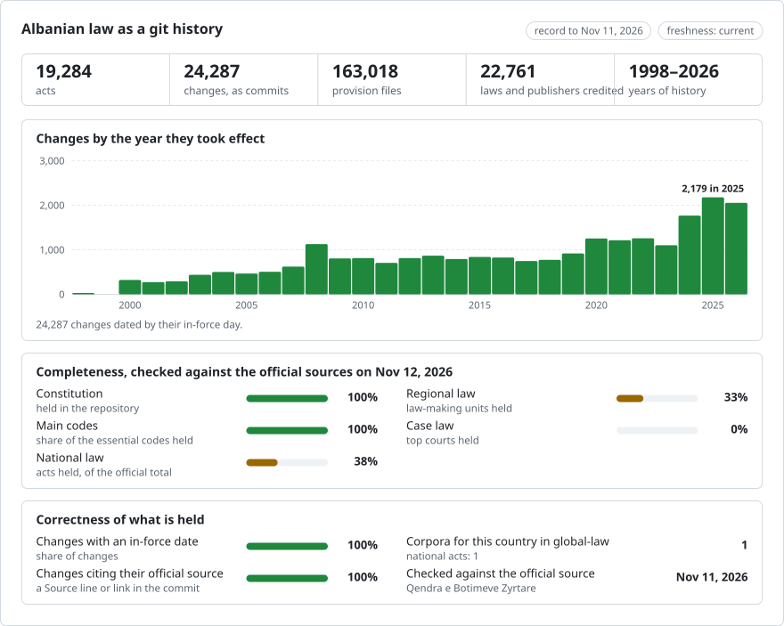

# Albania: law history in git

**English** · **[Ose lexojeni në shqip](README.md)**

<picture>
<source media="(prefers-color-scheme: dark)" srcset="data/effort-dark.svg">

</picture>

The law of Albania as a git history: one file per provision, one commit per version on the day it took effect, and the act that made each change as the commit's author. `git blame` names the act behind every paragraph; `git log` lists every change to an article; picking a date gives the text in force that day.

Part of [lexifina/global-law](https://github.com/lexifina/global-law), one git history for every country's law: this is Albania's national law, which global-law reads at `albania/national/acts/`.

**What is in it now:** the Constitution and 17,819 acts from the records of Qendra e Botimeve Zyrtare (QBZ, the official publisher): 2,188 laws, 10,918 decisions of the Council of Ministers, 1,504 instructions and 3,147 orders of ministers and other bodies, 54 normative acts and 8 decrees of the President, with 22,682 versions (2,724 of these acts have since been repealed); and 393 decisions of 20 municipal councils. [`registry/ACTS.md`](registry/ACTS.md) lists every act, by kind, with its status; [`data/pending.json`](data/pending.json) lists the laws published but not yet in force.

Each act is in `<kind>/<year>/<number>/` (`ligj/1995/7961/` is the Kodi i Punës, the Labour Code, ligji nr. 7961/1995; the Constitution is `kushtetuta/1998/`); instructions and orders add the day of adoption (`udhezim/2024/1212-1090/`), and council decisions are in `local/<municipality>/<year>/<number>/`. `registry/data/paths.json` maps each act id to its folder. Until 4 November 2026 the first acts' folders had other names (`kushtetuta/`, `ligji-8569-2000/`); `git log --follow`, `git blame` and `tools/on.py` reach back through the rename.

The text is in Albanian, as QBZ publishes it. An English translation is not part of this record.

## Questions as git commands

| Question | Command |
| --- | --- |
| Every change to Article 64 of the Constitution | `git log -p --word-diff --follow -- kushtetuta/1998/neni-064.md` |
| Which act wrote each line of Article 64? | `git blame kushtetuta/1998/neni-064.md` |
| Every version of the Constitution, with the day each took effect | `git log --format="%h %(trailers:key=In-force,valueonly,separator=) %an" -- kushtetuta` |
| Article 64 as in force on 1 January 2008 | `python tools/on.py 2008-01-01 kushtetuta/1998 neni-064` |

**Outside git**, we also host this record publicly, for free:

- **[Ask Claude about Albanian law](https://global-law.lexifina.com/v1/try_claude?country=albania)**: opens Claude with a first question ready.
- **[Ask ChatGPT](https://global-law.lexifina.com/v1/try_chatgpt?country=albania)**: the same question in ChatGPT.
- **[Call the API in your browser](https://global-law.lexifina.com/v1/search_law?query=pushimet+vjetore&jurisdictions=albania)**: a search of Albanian law for "pushimet vjetore", returned as JSON. See the [documentation here](https://lexifina.com/api/global-law).

Both assistants read the record through the free Global law connector (MCP, `https://global-law.lexifina.com/mcp`); the first time, the chat gives you the link that adds it. Ask in Albanian or in English.

**Host it yourself easily.** All it takes is git and Python, and the tools run on your machine:

```sh
git clone --depth 1 https://github.com/lexifina/global-law && cd global-law
python3 tools/countries.py add albania/national/acts
python3 tools/law.py show 2026-01-01 albania/national/acts/kushtetuta/1998/neni-064.md
```

Opened in Claude Code, Cursor, VS Code or Codex, the clone also starts a local MCP server with the same tools ([MCP.md](https://github.com/lexifina/global-law/blob/main/MCP.md)).

## Dates

Each commit is dated at noon, Europe/Tirane, on the day the version took effect, and carries it in its `In-force:` trailer (the days of adoption and publication are in `Enacted:` and `Published:`):

- for an act as published, the day its own clause gives, counted from the day its issue of the Fletorja Zyrtare was published: "hyn në fuqi pas botimit" or "menjëherë" is that day, "15 ditë pas botimit" fifteen days later, and a named day that day;
- for each later consolidated text, the day the act that changed it took effect (a normative act on adoption, Constitution art. 101; a Constitutional Court decision on publication, art. 132), not QBZ's own date for the version;
- for a repeal, an empty last version on the day the repealing act took effect;
- for a council decision, the day its own clause names, or else the latest day the law allows (announced within 10 days of adoption, in force 10 days later: Law 8652/2000 art. 33(6)).

Each version is credited to the act that made it, as QBZ names it (`Ligji nr. 115/2020`), with an address that cannot exist (`…@qbz.gov.al.invalid`); an act's first version is credited to the act itself. A change that neither QBZ's notes nor the changing act's text explains is credited to `Qendra e Botimeve Zyrtare` (755 commits).

## How current it is

- [data/freshness.json](data/freshness.json): when each act was last checked against QBZ (its record, its links to changing and repealing acts, its consolidated versions); due every 7 days for the Constitution, laws, Council of Ministers decisions, normative acts and decrees, every 30 for instructions, orders and council decisions. `python tools/freshness.py <act>` reads it.
- [data/status.json](data/status.json): whether updates are running and when QBZ last answered.

## How it is checked

- Every version is QBZ's own text, as published or as QBZ consolidated it. An act is published only when its text, dates and structure read cleanly and every change QBZ links to it has a version; otherwise it is held back.
- Before each batch is pushed, `tools/check_repo.py` reads every version back from git on the day it took effect and on the day before and compares it with the corpus; there must be no merge commit, no commit dated backwards or in the future, and every commit's trailers must parse.
- The Constitution's history is its seven amending laws replayed on the 1998 text and compared, provision by provision, with QBZ's consolidated editions of 2008, 2012, 2015, 2016 and today; every difference is listed in `REPRODUCE.md`.

## What it does not show

- **Acts held back.** 3,935 acts (2,720 national acts and 1,215 council decisions) whose text, dates or versions cannot yet be read with certainty, or that name private persons, are not here; [data/held.json](data/held.json) lists each with its reason and official page.
- **Changes QBZ does not consolidate.** 507 acts that later acts change, with no consolidated text from QBZ, are their text as published, labelled `amended, not consolidated`; `registry/data/acts.json` names the changing acts.
- **Earlier states of the six codes adopted before 2000** (Civil, Civil Procedure, Labour, Penal, Criminal Procedure, Road). Each has one version, QBZ's current consolidated edition: the codes as enacted are not available from official sources online.
- **Most councils.** 41 of the 61 municipal councils have no decision here yet ([data/local-coverage.json](data/local-coverage.json) says why), and later changes to a council decision are not tracked.
- **Case law, bills and drafts.** Constitutional Court decisions appear only as the act behind a change to a law.

## Sources

| Source | Kind | Past versions | Notes |
| --- | --- | --- | --- |
| [Qendra e Botimeve Zyrtare](https://qbz.gov.al) (QBZ), open API | Official publisher: Fletorja Zyrtare, acts, consolidated texts | yes, the consolidated versions it keeps for an act | Records from 2000: the text as published, each consolidated text and the act that changed it |
| QBZ, "Kodet e RSH-së" | Official consolidated editions of the codes | the current edition | The six codes adopted before 2000 |
| QBZ editions of the Constitution (2008, 2012, 2015, 2016), via the [Internet Archive](https://web.archive.org/) | Official consolidated editions | one per state | The Constitution's earlier wording |
| Kuvendi i Shqipërisë, "Kushtetuta e RSH.pdf" (2006), via the Internet Archive | The Assembly's copy of the 1998 text | n/a | The Constitution as enacted |
| The 61 municipal councils' own websites | Council decisions | as published | Law 139/2015 (art. 15(2), 18(3)) has each council publish its acts; there is no state register |

## Licence

See [`LICENSE`](LICENSE). The texts are official texts of the Republic of Albania; Albania's copyright law (ligji nr. 35/2016, neni 12, pika 1, shkronja "b") excludes legal acts and their official collections from copyright. Lexifina's arrangement, commit messages, tables and tools are CC0 1.0.

No AI model wrote, translated or corrected legal text; the scripts were written by an AI model, and no model runs when the history is built (see `REPRODUCE.md` and `registry/REPRODUCE.md`).

## More

From [lexifina/global-law](https://github.com/lexifina/global-law):

- [FEATURES.md](https://github.com/lexifina/global-law/blob/main/FEATURES.md): every feature, and what every corpus must support (`git blame`, `law.py`, the MCP tools)
- [FAQ.md](https://github.com/lexifina/global-law/blob/main/FAQ.md): questions and answers · [CONTRIBUTING.md](https://github.com/lexifina/global-law/blob/main/CONTRIBUTING.md): proposing changes · [MCP.md](https://github.com/lexifina/global-law/blob/main/MCP.md): the MCP server · [REPRODUCE.md](https://github.com/lexifina/global-law/blob/main/REPRODUCE.md): how it was built · [CHANGELOG.md](https://github.com/lexifina/global-law/blob/main/CHANGELOG.md)
- [FRESHNESS.md](https://github.com/lexifina/global-law/blob/main/FRESHNESS.md): how current each corpus is · [Monitoring](https://github.com/lexifina/global-law/tree/main/monitoring): whether updates are running · [WATCHING.md](https://github.com/lexifina/global-law/blob/main/WATCHING.md): how each official source is watched for changes
- [performance/](https://github.com/lexifina/global-law/tree/main/performance): how fast the tools are, measured
- [visualisations/](https://github.com/lexifina/global-law/tree/main/visualisations): charts and bridges across the world's law
- [Vulnerabilities](https://github.com/lexifina/global-law/tree/main/vulnerabilities): mistakes in legislation as published
