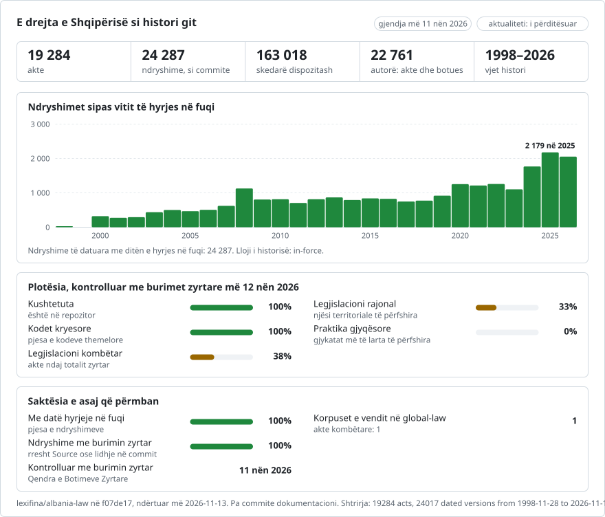

# Shqipëria: historia e së drejtës në git

**Shqip** · [English](README.en.md)

<picture>
<source media="(prefers-color-scheme: dark)" srcset="data/sq/effort-dark.svg">

</picture>

Pjesë e [lexifina/global-law](https://github.com/lexifina/global-law), një histori e vetme git për të drejtën e çdo vendi: ky është legjislacioni kombëtar i Shqipërisë, të cilin global-law e lexon te `albania/national/acts/`.

E drejta e Shqipërisë si histori git: një skedar për çdo dispozitë, një commit për çdo ligj në ditën e hyrjes së tij në fuqi, dhe ligji që bëri çdo ndryshim si autor i commit-it. `git blame` tregon ligjin pas çdo paragrafi; `git log` liston çdo ndryshim të një neni; kalimi (checkout) në një datë jep tekstin në fuqi atë ditë.

Ndjek modelin e përbashkët të [lexifina/global-law](https://github.com/lexifina/global-law), i cili e vendos te `al/`.

**Çfarë përmban.** Legjislacionin kombëtar të Shqipërisë, ashtu siç e mban Qendra e Botimeve Zyrtare (QBZ, botuesi zyrtar, qbz.gov.al) që nga viti 2000: Kushtetutën me gjithë historinë e saj, ligjet e Kuvendit, vendimet e Këshillit të Ministrave (VKM), aktet e tij normative me fuqinë e ligjit, dekretet normative të Presidentit për gjykatat, si dhe udhëzimet dhe urdhrat e ministrave dhe të organeve të tjera. Çdo akt është teksti i tij siç është botuar në Fletoren Zyrtare, pastaj çdo tekst i konsoliduar që QBZ boton pas çdo ndryshimi, i datuar me hyrjen në fuqi të vetë aktit ndryshues. [registry/ACTS.md](registry/ACTS.md) liston çdo akt; [registry/data/acts.json](registry/data/acts.json) jep statusin dhe faqen zyrtare të secilit.

| Statusi (registry/data/acts.json) | Kuptimi |
| --- | --- |
| `in force` | QBZ nuk lidh me të asnjë ndryshim që mungon në këtë repozitor |
| `amending act` | akt që synon të ndryshojë një akt tjetër: botohet ashtu siç është miratuar, në dosjen e vet |
| `amended, not consolidated` | QBZ (ose titulli apo teksti i një akti të mëvonshëm) përmend akte të mëvonshme që e ndryshojnë, por QBZ nuk boton tekst të konsoliduar: teksti këtu është akti siç është botuar; `amended_by` liston aktet ndryshuese dhe faqet e tyre zyrtare |
| `first version is a later consolidated text` | QBZ nuk jep tekstin e aktit siç është botuar (skedari i tij është një version i konsoliduar), prandaj versioni i parë tregon atë tekst të mëvonshëm; `label_note` përmend ndryshimin që ai përfshin |
| `repealed YYYY-MM-DD` | një version i fundit bosh regjistron shfuqizimin në ditën kur ai hyri në fuqi, i atribuuar aktit shfuqizues |
| `withdrawn` | një dublikatë e hequr me një commit korrigjimi të emërtuar; `withdrawn_by` e përmend atë |

Aktet, teksti, datat ose struktura e të cilave nuk lexohen qartë, mbahen mënjanë, jo në `main`; [data/held.json](data/held.json) liston secilin me arsyen dhe faqen zyrtare (ndër to akte bazë që QBZ i jep vetëm si PDF). Ligjet e miratuara, por ende jo në fuqi, janë në [data/pending.json](data/pending.json) dhe shtohen në ditën kur hyjnë në fuqi. Regjistrat në internet të QBZ-së fillojnë në vitin 2000. Kodet e miratuara para kësaj nuk kanë atje regjistër të tyrin, vetëm aktet e tyre ndryshuese; ato janë ndërtuar nga botimet zyrtare të konsoliduara të QBZ-së (shih [Kodet e para vitit 2000](#kodet-e-para-vitit-2000)). Vendimet e 61 këshillave bashkiakë janë në `local/` (shih [Aktet vendore](#aktet-vendore-këshillat-bashkiakë)).

## Përditësimi

Çdo version përmend faqen zyrtare nga e cila është lexuar (trailer-at e tij `Source:` dhe `Consolidated:`), kështu që çdo akt mund të kontrollohet me burimin e tij.

<!-- freshness-summary -->
Kontrolluar me burimet zyrtare: 2026-11-11; 100% e akteve të verifikuara në 7 ditët e fundit, 100% në 30 ditët e fundit ([data/freshness.json](data/freshness.json)).
<!-- /freshness-summary -->

`python tools/freshness.py <act>` jep statusin e një akti, kontrollin e tij të fundit dhe lidhjen zyrtare; `python tools/freshness.py --summary` jep pasqyrën e përgjithshme. Çdo akt kontrollohet duke lexuar regjistrin e QBZ-së për të, lidhjet e tij me aktet ndryshuese dhe shfuqizuese dhe versionet e tij të konsoliduara, dhe duke i krahasuar ato me versionin më të ri këtu. Kontrolli kryhet çdo javë; [data/status.json](data/status.json) tregon nëse përditësimet janë në punë dhe kur është përgjigjur QBZ për herë të fundit. Pragjet: 7 ditë për Kushtetutën, ligjet, vendimet e Këshillit të Ministrave, aktet normative dhe dekretet, 30 ditë për udhëzimet dhe urdhrat. Statuset (`current`, `pending-change`, `stale`, `unverified`, `source-unavailable`) dhe kolonat shpjegohen në [data/freshness.json](data/freshness.json). Aktet e etiketuara `amended, not consolidated` janë `pending-change`: QBZ raporton një ndryshim që asnjë tekst i konsoliduar këtu nuk e zbaton.

**Dosjet.** Çdo akt ndodhet në një dosje të emërtuar sipas identifikuesit të tij zyrtar, `<kind>/<year>/<number>/`: ligjet në `ligj/` (ligji nr. 8569/2000 në `ligj/2000/8569/`), Kushtetuta në `kushtetuta/1998/`, dhe vendimet, udhëzimet, urdhrat, aktet normative dhe dekretet e shtuara që atëherë në `vendim/`, `udhezim/`, `urdher/`, `aktnormativ/` dhe `dekret/`. Deri më 4 nëntor 2026 dosjet e akteve të mëparshme emërtoheshin sipas id-së së tyre (`kushtetuta/`, `ligji-8569-2000/`); commit-i që i riemërtoi nuk ndryshon asnjë tekst, prandaj `git log --follow` dhe `git blame` shkojnë prapa përmes tij, dhe mjetet i lexojnë të dy emrat. `registry/data/paths.json` lidh çdo id akti me dosjen e tij; `data/paths.json` liston aktet e këtij ndërtimi, si dhe 975 ligjet që ishin botuar dy herë, kopja e të cilave në `ligj/` u mbajt.

`README.md` i çdo akti në dosjen e tij liston çdo dispozitë, sa herë ka ndryshuar dhe kur. Teksti në fuqi sot është, dispozitë për dispozitë, botimi zyrtar i konsoliduar i botuar nga Qendra e Botimeve Zyrtare (QBZ).

## Kodet e para vitit 2000

Kodi Civil (ligji nr. 7850/1994), Kodi i Procedurës Civile (8116/1996), Kodi i Punës (7961/1995), Kodi Penal (7895/1995), Kodi i Procedurës Penale (7905/1995) dhe Kodi Rrugor (8378/1998) u miratuan para se të fillonin regjistrat në internet të QBZ-së, dhe QBZ nuk mban asnjë regjistër për to si akte, vetëm për ligjet që i ndryshuan. Secili është ndërtuar nga botimi zyrtar i konsoliduar i kodit nga QBZ ("Kodet e RSH-së", qbz.gov.al/publications/codes), në `ligj/<year>/<number>/`. Versioni i tij i vetëm është teksti i konsoliduar i sotëm, i etiketuar `first version is a later consolidated text`: kodi siç u miratua dhe gjendjet e tij të mëparshme nuk janë të disponueshme në internet nga burime zyrtare. Versioni datohet me ditën e hyrjes në fuqi të aktit ndryshues më të ri që përfshin botimi, dhe shënimet e QBZ-së për çdo nen ia atribuojnë atë akteve që e ndryshuan (`git blame` i përmend ato). Kodi i Procedurave Administrative (ligji nr. 44/2015), të cilin QBZ e liston vetëm si aktin që shfuqizoi kodin e mëparshëm, është ndërtuar nga teksti i tij siç është botuar. Kodi Penal Ushtarak (8003/1995) mbahet mënjanë: botimi i tij nuk përmend asnjë akt ndryshues dhe QBZ nuk ka asnjë regjistër për të, sipas të cilit të datohet.

## Aktet vendore (këshillat bashkiakë)

Ligji 139/2015 për vetëqeverisjen vendore kërkon që çdo këshill t'i botojë aktet e tij në faqen e vet zyrtare në internet (neni 15(2), 18(3)); nuk ka regjistër të mbajtur nga shteti. `local/<municipality>/<year>/<number>/` përmban vendimet e këshillave bashkiakë ashtu siç i botojnë faqet e tyre, një dosje për çdo vendim, të lexuara nga shtresa e tekstit e PDF-së ose, për vendimet e skanuara, me njohje optike të karaktereve (Tesseract, modeli për shqipen), ku shënimi i çdo versioni tregon se cila mënyrë u përdor. Një vendim botohet vetëm kur titulli i këshillit, numri dhe data lexohen qartë dhe përputhen me emrin e skedarit në faqe ose me ditën e mbledhjes në tekstin e tij; vendimet e kryesisë së këshillit, projektet, procesverbalet dhe rendet e ditës lihen jashtë. Vendimet që përmendin persona privatë (lista përfituesish, pronarësh, punonjësish) nuk botohen: [data/held.json](data/held.json) i liston me një lidhje te skedari i këshillit. Datat ndjekin ligjin: akti i këshillit shpallet brenda 10 ditëve nga miratimi dhe hyn në fuqi 10 ditë pas shpalljes (Ligji 8652/2000 neni 33(6); Ligji 139/2015); faqet nuk e botojnë ditën e shpalljes, prandaj vendimi datohet sipas dispozitës së vet kur ajo përmend një ditë, përndryshe në ditën më të vonë që lejon ligji. Ndryshimet e mëvonshme me vendime të tjera të këshillit nuk ndiqen (`council decision as adopted; later changes not tracked`). [data/local-coverage.json](data/local-coverage.json) jep, për secilën nga 61 bashkitë, ku i boton vendimet, çfarë u gjet, u botua dhe u mbajt mënjanë, dhe pse mungojnë disa (disa faqe refuzojnë klientët e automatizuar pas një sfide firewall-i, e cila nuk anashkalohet kurrë). Aktet vendore rikontrollohen çdo muaj me faqen e secilit këshill.

## Pyetjet e një juristi si komanda git

| Pyetja | Komanda |
| --- | --- |
| Çfarë thoshte neni 64 më 1 janar 2008? | `python tools/ne_fuqi_me.py 2008-01-01 kushtetuta 64` |
| E njëjta, vetëm me git (bash; për ditët para 4 nëntorit 2026, kur dosjet morën emrat e rinj) | `git show $(git rev-list -1 --before="2008-01-01T23:59:59Z" main -- kushtetuta/neni-064.md):kushtetuta/neni-064.md` |
| E njëjta, në PowerShell | `$r = git rev-list -1 --before="2008-01-01T23:59:59Z" main -- kushtetuta/neni-064.md; git show "$($r):kushtetuta/neni-064.md"` |
| Cili ligj shkroi çdo paragraf të nenit 131? | `git blame kushtetuta/1998/neni-131.md` |
| Çdo ndryshim i nenit 64, fjalë për fjalë | `git log -p --word-diff --follow kushtetuta/1998/neni-064.md` |
| Çdo ligj në regjistër, me radhë | `git log --reverse --format="%ad %an" --date=short main` |
| Gjithçka që ndryshoi një ligj | `git show law/ligji-76-2016` (etiketat `law/<key>` shënojnë commit-in e çdo ligji) |
| E gjithë Kushtetuta në një datë | `python tools/ne_fuqi_me.py 2010-01-01 kushtetuta` |

Emrat e skedarëve: `neni-064.md` është neni 64, `neni-006-01.md` neni 6/1, `neni-147-c-ced.md` neni 147/ç, `neni-147-e-uml.md` neni 147/ë; `aneks-neni-a.md` është neni A i Aneksit (2016); `pjesa-03-kreu-01.md` përmban titullin e Pjesës së Tretë, Kreu I; `kalimtare-ligji-9675.md` përmban dispozitat kalimtare të ligjit 9675/2007 që QBZ i shtyp pas nenit 183.

Pas një rindërtimi, rifreskoni etiketat me `git fetch --force --tags`: një fetch i thjeshtë i mban etiketat e vjetruara.

## Datat

- Çdo commit datohet në **mesditë, sipas orës Europe/Tirane, në ditën kur ndryshimi hyri në fuqi**. Datat e miratimit dhe të botimit janë trailer-a (`Enacted:`, `Published:`), dhe dita e hyrjes në fuqi është në `In-force:`, të cilin e lexojnë mjetet.
- **Rregulli i përgjithshëm.** Kushtetuta, neni 84(3): "Ligji hyn në fuqi me kalimin e jo më pak se 15 ditëve nga botimi i tij në Fletoren Zyrtare". Çdo ligj ndryshues e cakton vetë ditën: 9675/2007 dhe 137/2015 "hyn në fuqi menjëherë" (datuar në ditën kur e botoi Fletorja Zyrtare), dhe pesë të tjerët "15 ditë pas botimit" (dita e botimit + 15).
- **Vetë Kushtetuta** u miratua nga Kuvendi më 21 tetor 1998, u aprovua me referendum më 22 nëntor 1998 dhe u shpall me dekretin e Presidentit nr. 2260 më 28 nëntor 1998; sipas nenit 183 të saj, hyri në fuqi me shpalljen. Commit-i i saj i parë datohet 1998-11-28.
- Ditët e botimit janë datat e numrave të Fletores Zyrtare në regjistrat e qbz.gov.al, secila e kontrolluar me datën e shtypur në faqen e parë të atij numri. Datat e miratimit lexohen nga teksti i vetë çdo ligji: regjistri i aktit në qbz.gov.al është një ditë më herët për 88/2012 dhe 16/2022.
- `--before="YYYY-MM-DD"` pa orë përdor orën aktuale të ditës sipas orës suaj, kështu që një ligj që hyri në fuqi atë ditë mund të mos dalë para mesditës. Përdorni `T23:59:59Z` si më sipër, ose mjetin.

## Si u ndërtuan ligjet për tatimin mbi të ardhurat, për parandalimin e pastrimit të parave dhe për shtetësinë

Versioni i parë i çdo ligji është ligji siç është botuar në Fletoren Zyrtare (për ligjin nr. 29/2023, nr. 70, 2 maj 2023). Çdo version i mëvonshëm është teksti i konsoliduar që Qendra e Botimeve Zyrtare boton pas çdo akti që e ndryshoi ligjin, i datuar me hyrjen në fuqi të vetë atij akti: një ligj 15 ditë pas botimit (sipas dispozitës së vet), një akt normativ në ditën e miratimit ("hyn në fuqi menjëherë", Kushtetuta neni 101), dhe vendimi i Gjykatës Kushtetuese në ditën e botimit (neni 132). Shënimet e QBZ-së në tekstin e konsoliduar ("(Ndryshuar … me ligjin nr. 81/2025 …)") lihen jashtë skedarëve; çdo dispozitë që ndryshon në një version kontrollohet me to, ose me fjalët e vetë aktit ndryshues kur QBZ nuk shton shënim (zëvendësimi nga ligji 81/2025 i "mjete virtuale" me "kripto-aset" në të gjithë ligjin për tatimin mbi të ardhurat, dhe aneksi që ai shton); kur asnjëra nuk përmend ndryshim (pika 4 e nenit 24 të ligjit për shtetësinë, e hequr në tekstin e QBZ-së pas ligjit 77/2024), ndryshimi regjistrohet si i pashpjeguar, nga botuesi. Ligji për tatimin mbi të ardhurat i jep vetes efekt nga 1 janari 2024 (neni 72); historia i daton fjalët sipas hyrjes në fuqi, dhe datat e efektit janë në tekstin e vetë nenit 72.

## Si u rindërtua historia

Arkivi në internet i QBZ-së fillon në vitin 2000 dhe nuk mban versione të datuara të Kushtetutës, prandaj historia është rindërtuar:

1. **Teksti i vitit 1998** është kopja e vetë Kuvendit ("Kushtetuta e RSH.pdf", krijuar nga Word më 8 janar 2006 dhe e lidhur nga faqja e internetit e Kuvendit), e lexuar nga një kapje e Internet Archive e 25 majit 2006. Kjo është para ndryshimit të parë (13 janar 2007), prandaj është teksti siç u miratua.
2. **Çdo ligj ndryshues** lexohet nga .docx-i i tij zyrtar në qbz.gov.al dhe udhëzimet e tij zbatohen me radhë nga kodi i Lexifina-s: nene të tëra të zëvendësuara, të shtuara ose të shfuqizuara; paragrafë, shkronja dhe fraza të zëvendësuara, të shtuara ose të hequra; Pjesa e Dymbëdhjetë e shfuqizuar. Asnjë udhëzim nuk zbatohet me dorë.
3. **Fjalët e çdo versioni** vijnë nga botimi zyrtar i konsoliduar i QBZ-së për atë gjendje, kudo që ekziston një i tillë: botimet e 2008, 2012, 2015 dhe 2016 (kopje të qbz.gov.al në Internet Archive) dhe botimi i sotëm. Një dispozitë që nuk e ndryshon asnjë ligj i mëvonshëm lexohet gjatë gjithë kohës si në botimin e sotëm. Rizbatimi i ndryshimeve i jep fjalët vetëm aty ku nuk ka mbijetuar asnjë botim i asaj gjendjeje (formulimi i vitit 1998 i dispozitave të ndryshuara më vonë, dhe gjendjet pas 9675/2007 dhe 115/2020).

## Si kontrollohet

- **Rizbatimi kundrejt botimeve zyrtare.** Çdo ligj, i rizbatuar mbi tekstin para tij, krahasohet dispozitë për dispozitë me botimin e QBZ-së për gjendjen pas tij. Të 82 ndryshimet e dispozitave që bëjnë shtatë ligjet (73 dispozita të ndryshme) përputhen pasi lihen mënjanë hapësirat dhe vizat e ndarjes së fjalëve, me përjashtim të tri pikave të vogla tipografike në vetë tekstin e ligjit të 2016 (një pikë fundore e humbur aty ku takohen dy thonjëza mbyllëse në nenet 125 dhe 136, dhe "kushtetutshmerinë" në vend të "kushtetutshmërinë" në nenin 131). Çdo dallim është renditur në `REPRODUCE.md`.
- **Teksti i sotëm është teksti zyrtar.** Versioni i fundit është i njëjtë me botimin e konsoliduar të sotëm të QBZ-së, dispozitë për dispozitë.
- **Atribuimet kundrejt shënimeve të QBZ-së.** Çdo dispozitë e atribuuar një ligji përmendet në shënimin e vetë QBZ-së për atë ligj në botimin e sotëm ("Ndryshuar me ligjin nr. 9904, datë 21.4.2008"), dhe çdo shënim i tillë përputhet me një ndryshim të atribuuar.
- Çdo version i aktit lexohet përsëri nga git në ditën kur hyri në fuqi dhe një ditë më parë (`tools/check_repo.py`); të dyja duhet të përputhen me `corpus.json`. Kontrollet e gjendjes: asnjë commit bashkimi (merge), datat e commit-eve nuk shkojnë kurrë prapa, asgjë e datuar në të ardhmen, dhe trailer-at e çdo commit-i lexohen pa gabim.
- Repozitori rindërtohet për herë të dytë nga të njëjtat të dhëna dhe duhet të japë hash-e identike.

## Çfarë do të thotë "autor"

Autori i një commit-i është ligji që bëri ndryshimin, me një adresë e-maili që nuk mund të ekzistojë (`ligji-76-2016@qbz.gov.al.invalid`), kështu që `git blame` dhe `git log --author` tregojnë ligje. Committer-i është gjithmonë Lexifina. Commit-i i parë i atribuohet ligjit nr. 8417 (Kushtetuta siç u miratua). Blame atribuon rreshta të plotë (një paragraf për rresht); përdorni `git log -p --word-diff` për të parë saktësisht cilat fjalë ndryshoi një ligj.

## Çfarë nuk tregon

- **Fletorja Zyrtare e vitit 1998** (nr. 28/1998) nuk është në internet; teksti i vitit 1998 është kopja e Kuvendit. Ai ndryshon nga formulimi i QBZ-së për të njëjtat dispozita, të pandryshuara kurrë, vetëm në tipografi (shkronja të mëdha si "Forcat e Armatosura", disa theksa, thonjëza dhe presje, në 15 dispozita, të renditura në `REPRODUCE.md`; 7 të tjera ndryshojnë vetëm në hapësira). Këto dispozita lexohen ashtu siç i shtyp QBZ sot, prandaj dallime të tilla nuk shfaqen kurrë si ndryshime.
- **Ndryshimet redaksionale ndërmjet botimeve të QBZ-së** (hapësira, shkronja të mëdha, theksa të korrigjuar) nuk shfaqen si ndryshime, për të njëjtën arsye.
- **Vendimet e Gjykatës Kushtetuese** nuk ndryshojnë tekstin e Kushtetutës dhe nuk janë në regjistër.
- **Aktet para vitit 2000 dhe tekstet e konsoliduara që QBZ nuk i boton.** Kodi Civil (1994), Kodi Penal (1995) dhe akte të tjera të miratuara para vitit 2000 i paraprijnë arkivit në internet të QBZ-së dhe nuk janë ndërtuar. Një akt që QBZ e lidh si të ndryshuar, por për të cilin nuk mban tekst të konsoliduar, është teksti i tij siç është botuar, i etiketuar `amended, not consolidated`.

## Si ndërtohet

Lexifina lexon burimet e renditura këtu dhe regjistron versionet e datuara të çdo akti, si dhe ligjet që bënë çdo ndryshim, në një skedar korpusi. `tools/build.py` e shkruan këtë repozitor nga ai skedar, dhe i njëjti korpus jep gjithmonë të njëjtat hash-e të commit-eve; `REPRODUCE.md` jep hollësitë dhe kontrollet. Një model (Claude) shkroi kodin e Lexifina-s; ai nuk shkroi asnjë tekst ligjor, dhe asnjë model nuk ekzekutohet kur ndërtohet historia.

Asnjë model i inteligjencës artificiale nuk ka shkruar ose ndryshuar tekst ligjor. Claude Opus 5.5 shkroi skriptet dhe zgjodhi burimet; shih `REPRODUCE.md`.

## Burimet

| Burimi | Lloji | Versionet e mëparshme | Përmend aktin ndryshues | Shkarkim në masë | Shënime |
| --- | --- | --- | --- | --- | --- |
| [Qendra e Botimeve Zyrtare](https://qbz.gov.al) (QBZ), API e hapur JSON `qbz.gov.al/api/v1` | Botuesi zyrtar (fletorja, aktet, botimet e konsoliduara) | versione të konsoliduara për akt për disa ligje (`/acts/{id}/versions`, secili duke përmendur aktin që e ndryshoi); akte nga viti 2000 | ligjet ndryshuese janë akte më vete | për akt dhe për numër të fletores | Përdorur: .docx-i i çdo ligji ndryshues, datat e numrave të fletores dhe Kushtetuta e konsoliduar e sotme (PDF falas me shtresë teksti) |
| Botimet e Kushtetutës nga QBZ 2008, 2012, 2015, 2016, përmes [Internet Archive](https://web.archive.org/) | Botime zyrtare të konsoliduara | një për çdo gjendje | po, një shënim për çdo nen | nuk zbatohet | Përdorur si fjalët e çdo gjendjeje dhe për të kontrolluar rizbatimin |
| Kuvendi i Shqipërisë, "Kushtetuta e RSH.pdf" (2006), përmes Internet Archive | Kopja e Kuvendit e tekstit të vitit 1998 | nuk zbatohet | nuk zbatohet | nuk zbatohet | Përdorur për tekstin siç u miratua |

Udhëzues kërkimi që mbulojnë çdo vend: [GlobaLex](https://www.nyulawglobal.org/globalex/) dhe [Law Library of Congress Guide to Law Online](https://www.loc.gov/research-centers/law-library-of-congress/researcher-resources/guide-to-law-online/).

## Licenca

Tekstet ligjore janë tekste zyrtare të Republikës së Shqipërisë, të botuara nga Qendra e Botimeve Zyrtare dhe nga Kuvendi i Shqipërisë. Ligji shqiptar për të drejtën e autorit (ligji nr. 35/2016, neni 12, pika 1, shkronja "b") përjashton aktet ligjore dhe përmbledhjet e tyre zyrtare nga e drejta e autorit. Renditja, tabelat, mesazhet e commit-eve dhe mjetet janë të Lexifina-s, sipas kushteve në `LICENSE`.

Ky repozitor nuk është këshillë ligjore dhe nuk është botim zyrtar.

Ky është përkthim i versionit në anglisht ([README.en.md](README.en.md)); nëse ndryshojnë, vlen versioni në anglisht.

## Më shumë

Nga repozitori [lexifina/global-law](https://github.com/lexifina/global-law) (në anglisht):

- [FEATURES.md](https://github.com/lexifina/global-law/blob/main/FEATURES.md): të gjitha funksionet dhe çfarë duhet të mbështesë çdo korpus (`git blame`, `law.py`, mjetet MCP)
- [FAQ.md](https://github.com/lexifina/global-law/blob/main/FAQ.md): pyetje dhe përgjigje · [CONTRIBUTING.md](https://github.com/lexifina/global-law/blob/main/CONTRIBUTING.md): si të propozoni ndryshime · [MCP.md](https://github.com/lexifina/global-law/blob/main/MCP.md): serveri MCP · [REPRODUCE.md](https://github.com/lexifina/global-law/blob/main/REPRODUCE.md): si është ndërtuar · [CHANGELOG.md](https://github.com/lexifina/global-law/blob/main/CHANGELOG.md)
- [FRESHNESS.md](https://github.com/lexifina/global-law/blob/main/FRESHNESS.md): sa i përditësuar është çdo korpus · [Monitorimi](https://github.com/lexifina/global-law/tree/main/monitoring): nëse përditësimet funksionojnë · [WATCHING.md](https://github.com/lexifina/global-law/blob/main/WATCHING.md): si ndiqet çdo burim zyrtar për ndryshime
- [performance/](https://github.com/lexifina/global-law/tree/main/performance): sa të shpejta janë mjetet, të matura
- [visualisations/](https://github.com/lexifina/global-law/tree/main/visualisations): grafikë dhe lidhje në të drejtën e gjithë botës
- [Dobësitë](https://github.com/lexifina/global-law/tree/main/vulnerabilities): gabime në akte ashtu siç janë botuar
