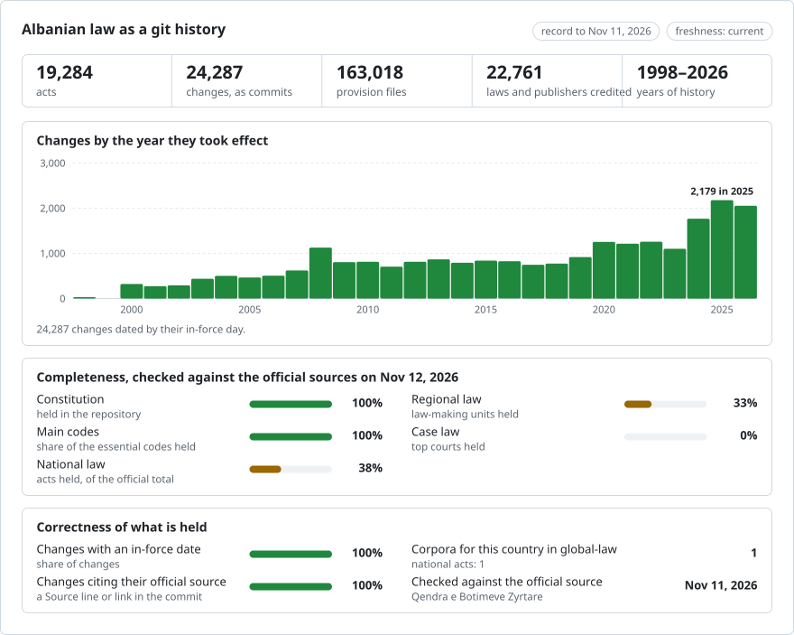

# Albania: law history in git

<picture>
<source media="(prefers-color-scheme: dark)" srcset="data/effort-dark.svg">

</picture>

Part of [lexifina/global-law](https://github.com/lexifina/global-law), one git history for every country's law: this is Albania's national law, which global-law reads at `albania/national/acts/`.

The law of Albania as a git history: one file per provision, one commit per law on the day it took effect, and the law that made each change as the commit's author. `git blame` names the law behind every paragraph; `git log` lists every change to an article; checking out a date gives the text in force that day.

It follows the shared design of [lexifina/global-law](https://github.com/lexifina/global-law), which places it at `al/`.

**What is in it.** Albania's national legislation as Qendra e Botimeve Zyrtare (QBZ, the official publisher, qbz.gov.al) holds it from 2000: the Constitution with its full history, the laws of the Assembly (ligje), the decisions of the Council of Ministers (VKM), its acts with the force of law (akte normative), the normative decrees of the President on the courts (dekrete), and the instructions (udhëzime) and orders (urdhra) of ministers and other bodies. Each act is its text as published in the Fletorja Zyrtare, then every consolidated text QBZ publishes after each change, dated by the changing act's own entry into force. [registry/ACTS.md](registry/ACTS.md) lists every act; [registry/data/acts.json](registry/data/acts.json) gives each one's status and official page.

| Status (registry/data/acts.json) | Meaning |
| --- | --- |
| `in force` | QBZ links no change to it that this repository lacks |
| `amending act` | an act whose purpose is to change another: published as enacted, in its own folder |
| `amended, not consolidated` | QBZ (or a later act's title or text) names later acts that change it, but QBZ publishes no consolidated text: the text here is the act as published; `amended_by` lists the changing acts and their official pages |
| `first version is a later consolidated text` | QBZ gives no text of the act as published (its file is a consolidated version), so the first version shows that later text; `label_note` names the change it includes |
| `repealed YYYY-MM-DD` | an empty last version records the repeal on the day it took effect, credited to the repealing act |
| `withdrawn` | a duplicate removed by a labelled correction commit; `withdrawn_by` names it |

Acts whose text, dates or structure do not read cleanly are held back, not on `main`; [data/held.json](data/held.json) lists each with its reason and official page (among them base acts QBZ gives only as a PDF). Laws passed but not yet in force are in [data/pending.json](data/pending.json) and are appended on the day they take effect. QBZ's online records start in 2000. The codes adopted before it have no record of their own there, only their amending acts; they are built from QBZ's official consolidated editions (see [Codes from before 2000](#codes-from-before-2000)). The decisions of the 61 municipal councils are in `local/` (see [Local acts](#local-acts-municipal-councils)).

## Freshness

Every version names the official page it was read from (its `Source:` and `Consolidated:` trailers), so every act can be checked against its source.

<!-- freshness-summary -->
Checked against the official sources: 2026-11-11; 100% of acts verified in the last 7 days, 100% in the last 30 ([data/freshness.json](data/freshness.json)).
<!-- /freshness-summary -->

`python tools/freshness.py <act>` gives an act's status, its last check and the official link; `python tools/freshness.py --summary` the overall picture. Each act is checked by reading QBZ's record of it, its links to changing and repealing acts and its consolidated versions, and comparing them with the newest version here. The check runs weekly; [data/status.json](data/status.json) says whether updates are running and when QBZ last answered. Thresholds: 7 days for the Constitution, laws, Council of Ministers decisions, normative acts and decrees, 30 days for instructions and orders. Statuses (`current`, `pending-change`, `stale`, `unverified`, `source-unavailable`) and columns are explained in [data/freshness.json](data/freshness.json). Acts labelled `amended, not consolidated` are `pending-change`: QBZ reports a change that no consolidated text here applies.

**Folders.** Every act lives in a folder named by its official identifier, `<kind>/<year>/<number>/`: the laws in `ligj/` (ligji nr. 8569/2000 in `ligj/2000/8569/`), the Constitution in `kushtetuta/1998/`, and the decisions, instructions, orders, normative acts and decrees appended since in `vendim/`, `udhezim/`, `urdher/`, `aktnormativ/` and `dekret/`. Until 4 November 2026 the earlier acts' folders were named by their id (`kushtetuta/`, `ligji-8569-2000/`); the commit that renamed them changes no text, so `git log --follow` and `git blame` reach back through it, and the tools read both names. `registry/data/paths.json` maps every act id to its folder; `data/paths.json` lists this build's acts, and the 975 laws that had been published twice, whose copy in `ligj/` was kept.

The per-act `README.md` in each folder lists every provision, how often it changed and when. The text in force today is, provision for provision, the official consolidated edition published by Qendra e Botimeve Zyrtare (QBZ).

## Codes from before 2000

The Civil Code (ligji nr. 7850/1994), the Code of Civil Procedure (8116/1996), the Labour Code (7961/1995), the Penal Code (7895/1995), the Code of Criminal Procedure (7905/1995) and the Road Code (8378/1998) were adopted before QBZ's online records begin, and QBZ keeps no record of them as acts, only of the laws that amended them. Each is built from QBZ's official consolidated edition of the code ("Kodet e RSH-së", qbz.gov.al/publications/codes), in `ligj/<year>/<number>/`. Its one version is today's consolidated text, labelled `first version is a later consolidated text`: the code as enacted and its earlier states are not available from official sources online. The version is dated by the in-force day of the newest amending act the edition includes, and QBZ's notes on each article credit it to the acts that changed it (`git blame` names them). The Code of Administrative Procedure (ligji nr. 44/2015), which QBZ lists only as the act that repealed the earlier code, is built from its text as published. The Military Penal Code (8003/1995) is held: its edition names no amending act and QBZ has no record of it to date it by.

## Local acts (municipal councils)

Law 139/2015 on local self-government requires every council to publish its acts on its own official website (art. 15(2), 18(3)); there is no state-run register. `local/<municipality>/<year>/<number>/` holds the decisions (vendime) of the municipal councils as their own sites publish them, one folder per decision, read from the PDF's text layer or, for scanned decisions, by optical character recognition (Tesseract, Albanian model), each version's note saying which. A decision is published only when its council header, number and date read cleanly and agree with the file's name on the site or the meeting day in its text; decisions of a council's presidency, drafts, minutes and agendas are left out. Decisions that name private persons (lists of beneficiaries, property owners, staff) are not published: [data/held.json](data/held.json) lists them with a link to the council's file. Dates follow the law: a council act is announced within 10 days of its adoption and enters into force 10 days after the announcement (Law 8652/2000 art. 33(6); Law 139/2015); the sites do not publish the announcement day, so a decision is dated by its own clause when that names a day, otherwise at the latest day the law allows. Later amendments by other council decisions are not tracked (`council decision as adopted; later changes not tracked`). [data/local-coverage.json](data/local-coverage.json) gives, for each of the 61 municipalities, where it publishes its decisions, what was found, published and held, and why any are missing (some sites refuse automated clients behind a firewall challenge, which is never bypassed). Local acts are re-checked monthly against each council's site.

## A lawyer's questions as git commands

| Question | Command |
| --- | --- |
| What did art. 64 say on 1 January 2008? | `python tools/ne_fuqi_me.py 2008-01-01 kushtetuta 64` |
| The same, with raw git (bash; days before 4 November 2026, when the folders took their new names) | `git show $(git rev-list -1 --before="2008-01-01T23:59:59Z" main -- kushtetuta/neni-064.md):kushtetuta/neni-064.md` |
| The same, in PowerShell | `$r = git rev-list -1 --before="2008-01-01T23:59:59Z" main -- kushtetuta/neni-064.md; git show "$($r):kushtetuta/neni-064.md"` |
| Which law wrote each paragraph of art. 131? | `git blame kushtetuta/1998/neni-131.md` |
| Every change to art. 64, word by word | `git log -p --word-diff --follow kushtetuta/1998/neni-064.md` |
| Every law in the record, in order | `git log --reverse --format="%ad %an" --date=short main` |
| Everything one law changed | `git show law/ligji-76-2016` (tags `law/<key>` mark each law's commit) |
| The whole Constitution on a date | `python tools/ne_fuqi_me.py 2010-01-01 kushtetuta` |

File names: `neni-064.md` is art. 64, `neni-006-01.md` art. 6/1, `neni-147-c-ced.md` art. 147/ç, `neni-147-e-uml.md` art. 147/ë; `aneks-neni-a.md` is art. A of the Annex (2016); `pjesa-03-kreu-01.md` holds the heading of Part Three, Chapter I; `kalimtare-ligji-9675.md` holds the transitional provisions of law 9675/2007 that QBZ prints after art. 183.

After a rebuild, refresh tags with `git fetch --force --tags`: a plain fetch keeps stale tags.

## Dates

- Each commit is dated at **noon, Europe/Tirane, on the day the change took effect**. Enactment and publication dates are trailers (`Enacted:`, `Published:`), and the in-force day is in `In-force:`, which the tools read.
- **Default rule.** Constitution art. 84(3): "Ligji hyn në fuqi me kalimin e jo më pak se 15 ditëve nga botimi i tij në Fletoren Zyrtare" (a law takes effect no sooner than 15 days after its publication in the Fletorja Zyrtare). Each amending law sets its own day: 9675/2007 and 137/2015 "hyn në fuqi menjëherë" (dated to the day the Fletorja Zyrtare published it), and the other five "15 ditë pas botimit" (publication day + 15).
- **The Constitution itself** was adopted by the Assembly on 21 October 1998, approved by referendum on 22 November 1998 and promulgated by presidential decree nr. 2260 on 28 November 1998; by its art. 183 it took effect on promulgation. Its first commit is dated 1998-11-28.
- Publication days are the Fletorja Zyrtare issue dates in qbz.gov.al's records, each checked against the date printed on that issue's first page. Enactment dates are read from each law's own text: qbz.gov.al's act record is a day early for 88/2012 and 16/2022.
- `--before="YYYY-MM-DD"` alone uses your clock's time of day, so a law that took effect that day may be missed before noon. Use `T23:59:59Z` as above, or the tool.

## How the income tax, anti-money-laundering and citizenship laws were built

Each law's first version is the law as published in the Fletorja Zyrtare (for ligji nr. 29/2023, nr. 70, 2 May 2023). Each later version is the consolidated text Qendra e Botimeve Zyrtare publishes after each act that changed the law, dated by that act's own entry into force: a law 15 days after its publication (its own clause), a normative act on the day it was adopted ("hyn në fuqi menjëherë", Constitution art. 101), and the Constitutional Court decision on the day it was published (art. 132). QBZ's notes in the consolidated text ("(Ndryshuar … me ligjin nr. 81/2025 …)") are left out of the files; every provision that changes in a version is checked against them, or against the changing act's own words where QBZ adds no note (law 81/2025's replacement of "mjete virtuale" by "kripto-aset" throughout the income tax law, and the annex it adds); where neither names a change (point 4 of art. 24 of the citizenship law, dropped in QBZ's text after law 77/2024), the change is recorded as unexplained, from the publisher. The income tax law gives itself effect from 1 January 2024 (art. 72); the history dates the words by entry into force, and the dates of effect are in art. 72's own text.

## How the history was rebuilt

QBZ's online archive starts in 2000 and keeps no dated versions of the Constitution, so the history is rebuilt:

1. **The 1998 text** is the Assembly's own copy ("Kushtetuta e RSH.pdf", made from Word on 8 January 2006 and linked from the Assembly's website), read from an Internet Archive capture of 25 May 2006. That is before the first amendment (13 January 2007), so it is the text as enacted.
2. **Each amending law** is read from its official .docx on qbz.gov.al and its instructions are applied in turn by Lexifina's code: whole articles replaced, added or repealed; paragraphs, letters and phrases replaced, added or deleted; Part Twelve repealed. No instruction is applied by hand.
3. **The words of each version** come from QBZ's official consolidated edition of that state wherever one exists: the editions of 2008, 2012, 2015 and 2016 (Internet Archive copies of qbz.gov.al) and today's edition. A provision that no later law changes reads as in today's edition throughout. The replay supplies the words only where no edition of that state survives (the 1998 wording of provisions later amended, and the states after 9675/2007 and 115/2020).

## How it is checked

- **Replay against the official editions.** Each law, replayed on the text before it, is compared provision by provision with QBZ's edition of the state after it. All 82 provision changes the seven laws make (73 distinct provisions) match once whitespace and word-division hyphens are set aside, except three small typographic points in the 2016 law's own text (a final period lost where two closing quotes meet in arts. 125 and 136, and "kushtetutshmerinë" for "kushtetutshmërinë" in art. 131). Every difference is listed in `REPRODUCE.md`.
- **Today's text is the official text.** The last version equals QBZ's consolidated edition of today, provision for provision.
- **Credits against QBZ's notes.** Every provision credited to a law is named in QBZ's own note for that law in today's edition ("Ndryshuar me ligjin nr. 9904, datë 21.4.2008"), and every such note matches a credited change.
- Every version of the act is read back from git on the day it took effect and on the day before (`tools/check_repo.py`); both must match `corpus.json`. Health checks: no merge commits, commit dates never go backwards, nothing dated in the future, and every commit's trailers parse.
- The repository is rebuilt from the same data a second time and must give identical hashes.

## What "author" means

The author of a commit is the law that made the change, with an e-mail address that cannot exist (`ligji-76-2016@qbz.gov.al.invalid`), so `git blame` and `git log --author` name laws. The committer is always Lexifina. The first commit is credited to ligji nr. 8417 (the Constitution as enacted). Blame credits whole lines (one paragraph per line); use `git log -p --word-diff` to see exactly which words a law changed.

## What it does not show

- **The Fletorja Zyrtare of 1998** (nr. 28/1998) is not online; the 1998 text is the Assembly's copy. It differs from QBZ's wording of the same, never-amended provisions only in typography (capitals such as "Forcat e Armatosura", a few accents, quotes and commas, in 15 provisions, listed in `REPRODUCE.md`; 7 more differ only in spacing). Those provisions read as QBZ prints them today, so such differences never appear as changes.
- **Editorial changes between QBZ editions** (spacing, capitals, corrected accents) are not shown as changes, for the same reason.
- **Rulings of the Constitutional Court** do not change the text of the Constitution and are not in the record.
- **Acts before 2000 and consolidated texts QBZ does not publish.** The Civil Code (1994), the Penal Code (1995) and other acts adopted before 2000 predate QBZ's online archive and are not built. An act QBZ links as changed but keeps no consolidated text of is its text as published, labelled `amended, not consolidated`.

## How it is built

Lexifina reads the sources listed here and records each act's dated versions, and the laws that made each change, in one corpus file. `tools/build.py` writes this repository from that file, and the same corpus always gives the same commit hashes; `REPRODUCE.md` gives the details and the checks. A model (Claude) wrote Lexifina's code; it wrote no legal text, and no model runs when the history is built.

No AI model wrote or changed legal text. Claude Opus 5.5 wrote the scripts and chose the sources; see `REPRODUCE.md`.

## Sources

| Source | Kind | Past versions | Names the amending act | Bulk | Notes |
| --- | --- | --- | --- | --- | --- |
| [Qendra e Botimeve Zyrtare](https://qbz.gov.al) (QBZ), open JSON API `qbz.gov.al/api/v1` | Official publisher (gazette, acts, consolidated editions) | consolidated versions per act for some laws (`/acts/{id}/versions`, each naming the act that changed it); acts from 2000 | the amending laws are separate acts | per act and per gazette issue | Used: the .docx of each amending law, the gazette issue dates, and today's consolidated Constitution (free PDF with a text layer) |
| QBZ editions of the Constitution 2008, 2012, 2015, 2016, via the [Internet Archive](https://web.archive.org/) | Official consolidated editions | one per state | yes, a note per article | n/a | Used as the words of each state and to check the replay |
| Kuvendi i Shqipërisë, "Kushtetuta e RSH.pdf" (2006), via the Internet Archive | The Assembly's copy of the 1998 text | n/a | n/a | n/a | Used for the text as enacted |

Research guides that cover every country: [GlobaLex](https://www.nyulawglobal.org/globalex/) and the [Law Library of Congress Guide to Law Online](https://www.loc.gov/research-centers/law-library-of-congress/researcher-resources/guide-to-law-online/).

## Licence

The legal texts are official texts of the Republic of Albania, published by Qendra e Botimeve Zyrtare and by the Assembly of Albania. Albania's copyright law (ligji nr. 35/2016, neni 12, pika 1, shkronja "b") excludes legal acts and their official collections from copyright. The arrangement, tables, commit messages and tools are by Lexifina, under the terms in `LICENSE`.

This repository is not legal advice and not an official publication.

## Shqip

Historia e së drejtës shqiptare në git: një skedar për çdo dispozitë dhe një commit për çdo ligj, me datën e hyrjes së tij në fuqi dhe me ligjin që bëri ndryshimin si autor (`git blame` tregon ligjin e çdo paragrafi). Përmban Kushtetutën e Republikës së Shqipërisë që nga hyrja në fuqi më 28 nëntor 1998, me të shtatë ligjet që e kanë ndryshuar (nr. 9675/2007, 9904/2008, 88/2012, 137/2015, 76/2016, 115/2020 dhe 16/2022), deri sot. Përmban gjithashtu ligjin nr. 29/2023 “Për tatimin mbi të ardhurat”, që nga hyrja në fuqi më 17 maj 2023, me tekstin e konsoliduar zyrtar të QBZ-së pas secilit prej gjashtë akteve që e kanë ndryshuar, deri sot; po ashtu ligjin nr. 9917/2008 “Për parandalimin e pastrimit të parave dhe financimit të terrorizmit” dhe ligjin nr. 113/2020 “Për shtetësinë”, me çdo ndryshim të tyre.

- Teksti në fuqi në një datë: `python tools/ne_fuqi_me.py 2008-01-01 kushtetuta 64`
- Datat: neni 84, pika 3, i Kushtetutës (ligji hyn në fuqi jo më pak se 15 ditë pas botimit në Fletoren Zyrtare); çdo ligj ndryshues e cakton vetë ditën ("menjëherë" ose "15 ditë pas botimit").
- Si u rindërtua: teksti i vitit 1998 është kopja e Kuvendit (PDF, 2006, nga Internet Archive); çdo ligj ndryshues zbatohet me radhë mbi tekstin e mëparshëm, dhe fjalët e çdo versioni merren nga botimi zyrtar i konsoliduar i QBZ-së për atë gjendje (2008, 2012, 2015, 2016 dhe sot) kudo që ekziston. Teksti i fundit është, dispozitë për dispozitë, botimi zyrtar i sotëm i QBZ-së.
- Kodet e para vitit 2000 (Kodi Civil, Kodi i Procedurës Civile, Kodi i Punës, Kodi Penal, Kodi i Procedurës Penale, Kodi Rrugor) janë ndërtuar nga botimet zyrtare të konsoliduara të QBZ-së; versioni i tyre i parë këtu është teksti i konsoliduar i sotëm.
- Aktet vendore: vendimet e këshillave bashkiakë, në `local/<bashkia>/<viti>/<numri>/`, ashtu siç i boton çdo bashki në faqen e saj zyrtare (ligji nr. 139/2015, neni 15, pika 2).
- Burimi: Qendra e Botimeve Zyrtare (qbz.gov.al), Kuvendi i Shqipërisë dhe faqet zyrtare të bashkive. Asnjë model i inteligjencës artificiale nuk ka shkruar tekst ligjor.
