# Albanian law in 20 charts

[Shqip](README.md)

Charts on every country's law, from the whole of global-law: [global-law visualisations/](https://github.com/lexifina/global-law/tree/main/visualisations). These are the charts on Albania alone.

Twenty charts on Albanian law, drawn only from the data in this repository: the laws of the Assembly and the block of adoption and promulgation at their end, the normative acts with the force of law, the decisions of the Council of Ministers, the instructions and orders of ministers, the Constitution and its amendments, court decisions published in the Official Journal (Fletorja Zyrtare), and every version of these acts in the git history.

Open [`e-drejta-shqiptare-ne-20-grafike.html`](e-drejta-shqiptare-ne-20-grafike.html) in a browser. The page is one file with all its data inside; it loads only the d3 and topojson libraries, the world map of chart 19 and its fonts from the web. The controls at the top right switch the language (Albanian or English) and the theme (light or dark). Each chart names its data path in the repository, its record count and its limits, and has a table of every number under it. Hover over a mark for the exact values.

The charts are descriptive: they show what the sources record, not why.

## The charts

### I. The Assembly and the President

#### 1. Laws and decisions

How many laws the Assembly and how many decisions the Council of Ministers adopt each year, by the numbers they were given, and how many of them the repository holds: 146 laws and 952 decisions a year on average.

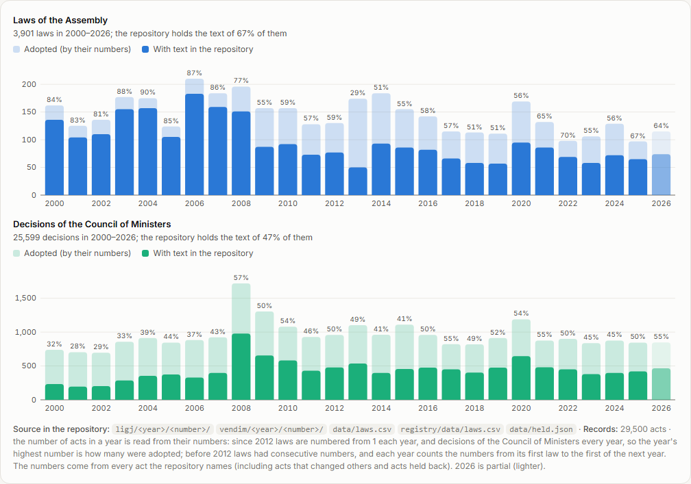

#### 2. The Assembly's calendar

Laws by the month and weekday they were adopted: 72% on a Thursday, only 2 in August over 27 years.

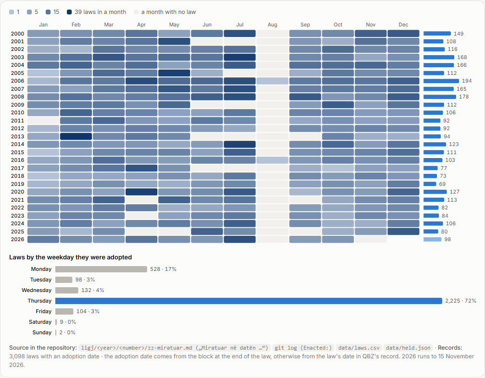

#### 3. New laws are getting longer

New laws by their number of articles, for each five-year period: a median of 17.5 articles, then 31.

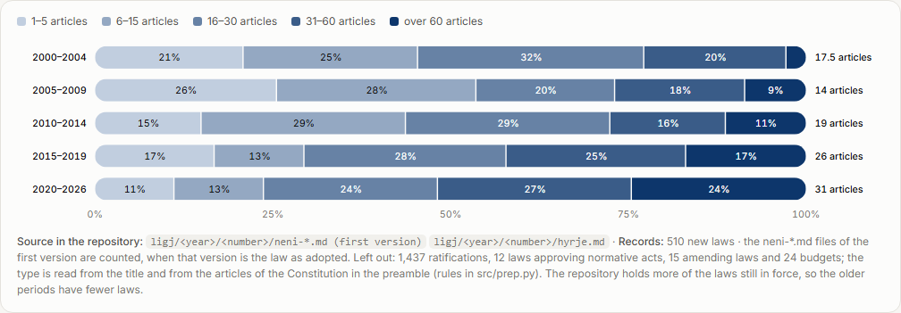

#### 4. The Assembly beyond laws

The Assembly's decisions, resolutions and declarations of 2000–2010, by what the title says.

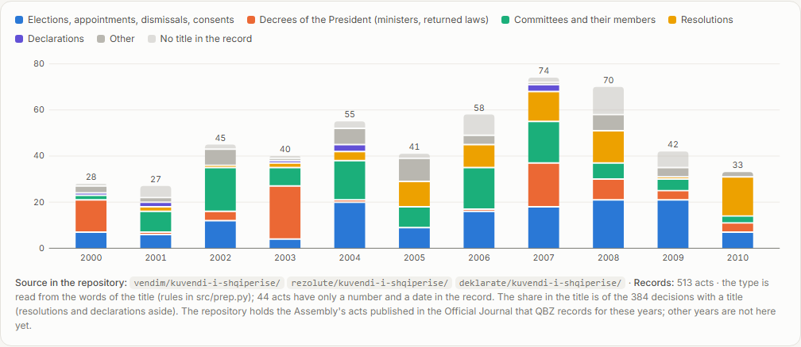

#### 5. Promulgation

The President's decree for each law, by year and President: in 2021, half of the laws were published without a decree.

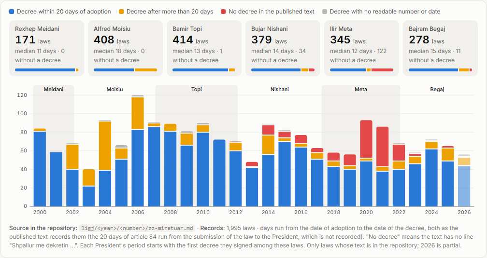

### II. The government as lawmaker

#### 6. Normative acts with the force of law

Every normative act under article 101 since 2000, by quarter, subject and Prime Minister: 38 in 2020, 36 in 2021.

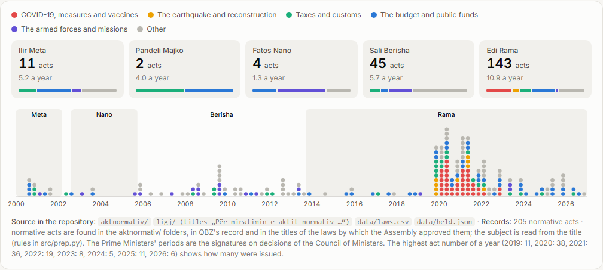

#### 7. The 45-day deadline

How many days after the normative act the Assembly approved it: 197 of 198 in time.

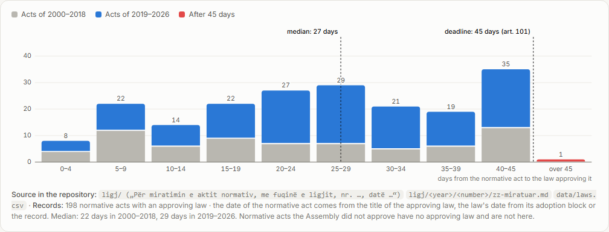

#### 8. Who proposes the government's decisions

The proposer of decisions of the Council of Ministers, by area and year.

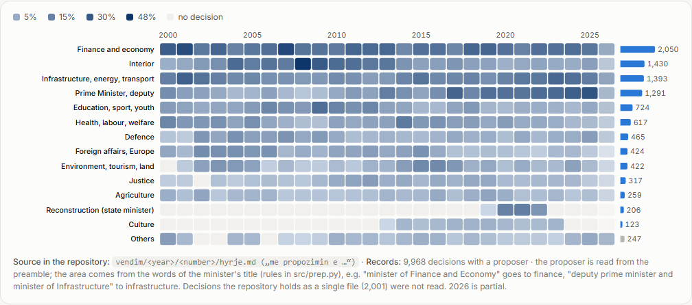

#### 9. From the government's meeting to the Official Journal

Days from adoption to publication for decisions of the Council of Ministers and for laws: 36 in 2009, 2 in 2025.

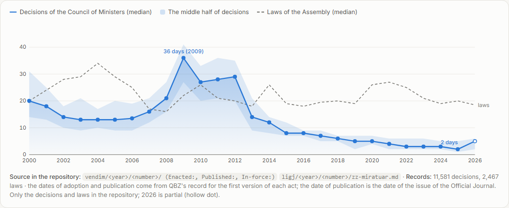

#### 10. Expropriations in the public interest

Expropriation decisions by project and decade: 52% for roads.

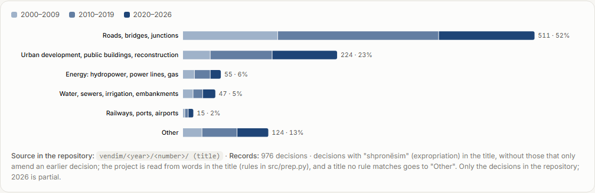

#### 11. Concessions

Decisions and laws on concessions by year and sector: 274 acts on hydropower plants, 128 of them in 2007–2008.

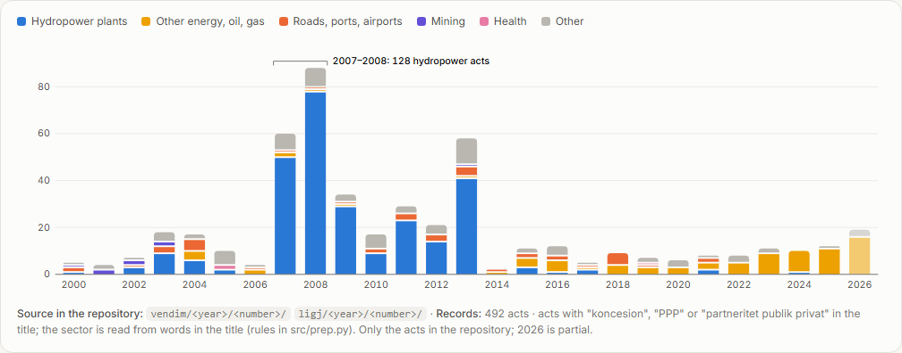

### III. Ministers and the numbers the law sets

#### 12. Instructions and orders

Instructions and orders by the institution that issued them: 36% from the Ministry of Agriculture.

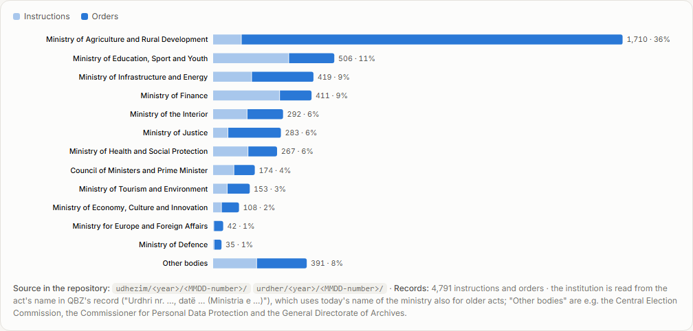

#### 13. Animal diseases

Orders with protective measures against animal diseases that appeared in other states, by disease and month, and how long they stayed in force.

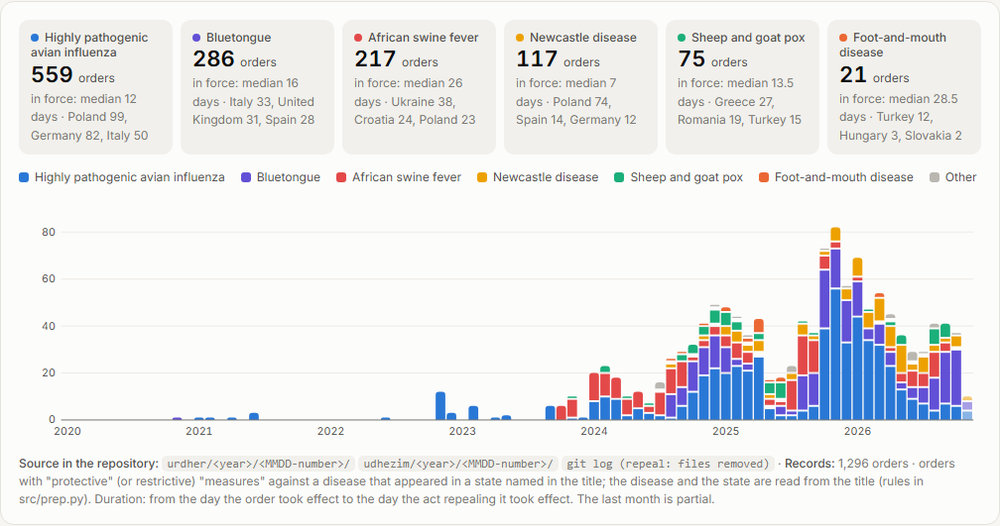

#### 14. The minimum wage

Every minimum wage amount since 2000, and the percentage of each pension rise.

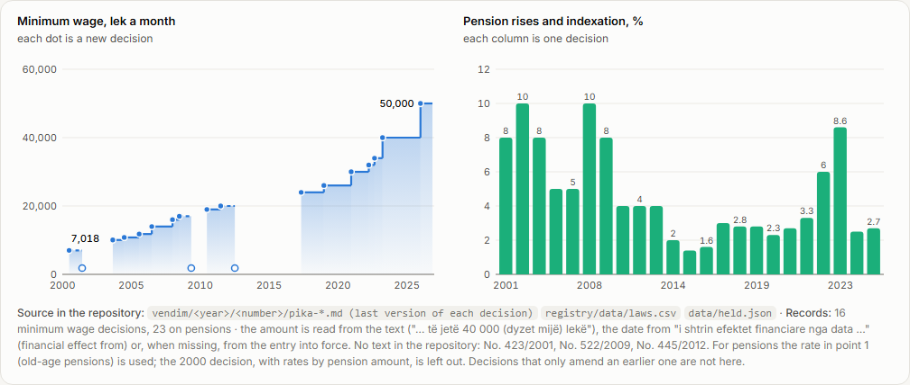

### IV. How acts change and end

#### 15. Repeals

Acts repealed and new versions each year, by kind of act, with the orders on animal diseases apart.

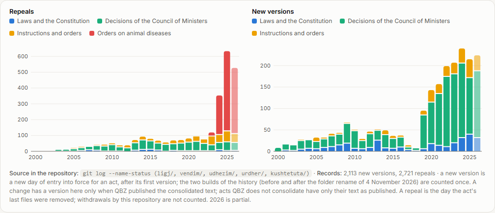

#### 16. The acts changed most often

New versions a year for the 20 acts changed most often; five are decisions on the reconstruction fund after the 2019 earthquake.

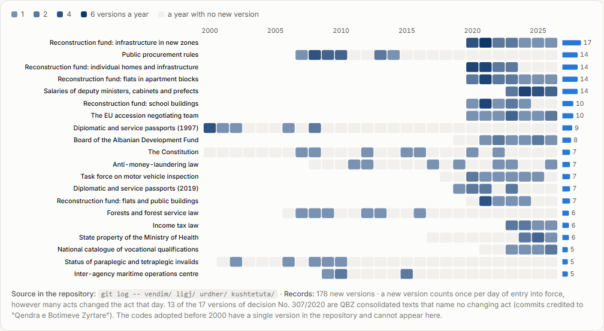

### V. The Constitution, the courts and international agreements

#### 17. The Constitution

The provisions each of the seven amending laws added, changed or repealed, by part: 57 in 2016.

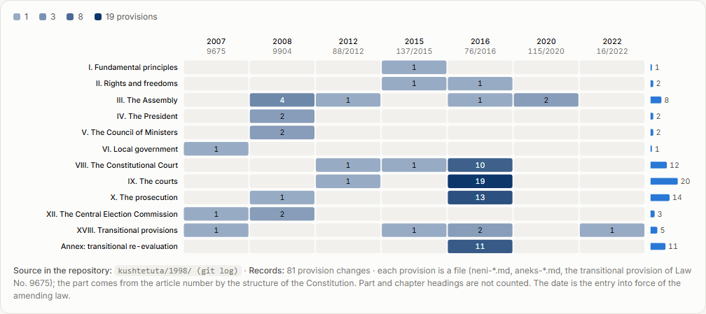

#### 18. The courts in the Official Journal

Decisions of the Constitutional Court, the High Court, the European Court of Human Rights and the district courts, by year, and the days to publication.

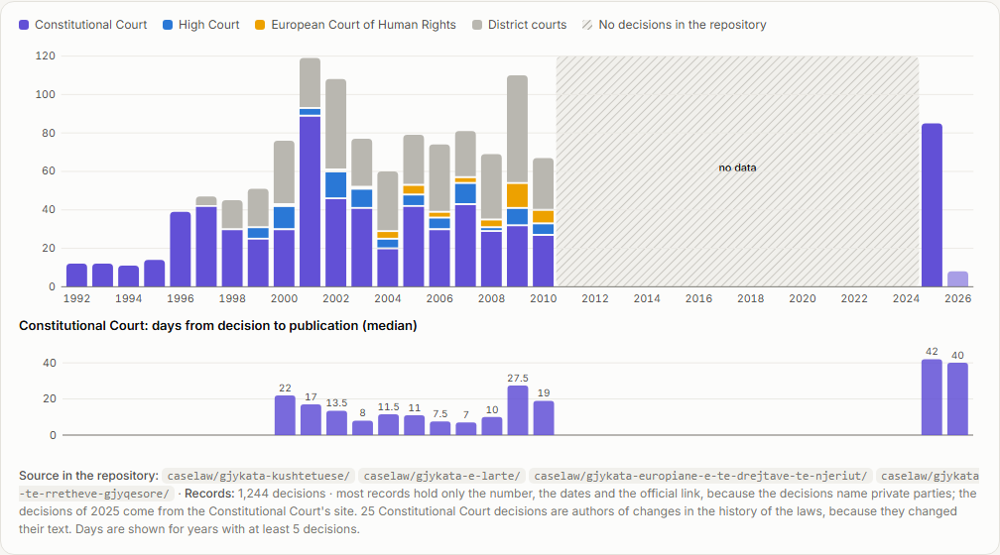

#### 19. Who Albania signs agreements with

Ratification laws by state, on a map and by decade.

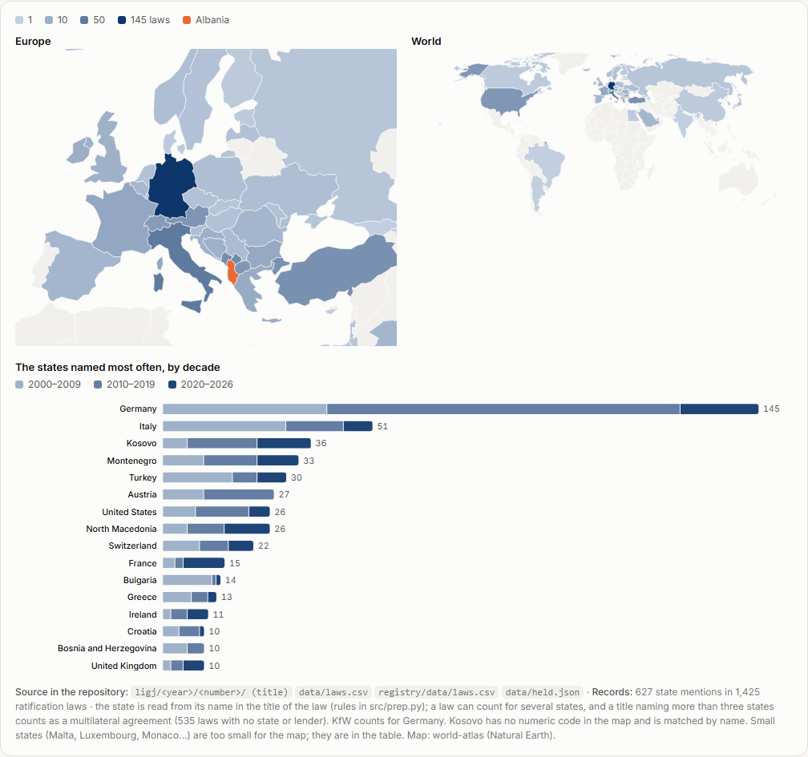

#### 20. What is ratified

Ratification laws by subject and, for loans and financing, by lender.

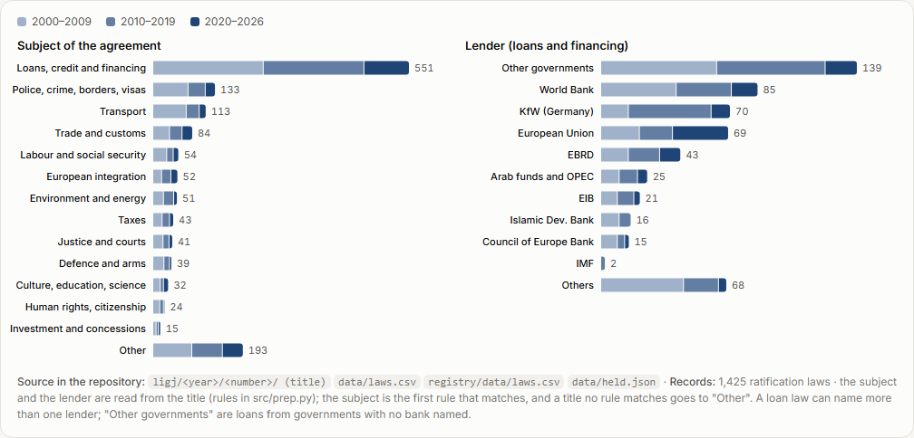

## Data

As of commit `0db29a98f9` (15 November 2026).

| Dataset | Where in the repository | Records | Coverage |
| --- | --- | ---: | --- |
| Git history | branch `main` | 31,900 commits | the date of each commit with legal text is the day the version took effect (`In-force:`) |
| Constitution | `kushtetuta/1998/` | 8 versions | 1998–2022: the 1998 text and its seven amending laws |
| Laws | `ligj/<year>/<number>/` | 2,644 laws (2,525 in force); 3,155 laws known in all | 1991–2026, mostly since 2000 |
| Normative acts with the force of law | `aktnormativ/` and the titles of the laws approving them | 54 acts with text; 205 known | 2000–2026 |
| Decisions of the Council of Ministers | `vendim/<year>/<number>/` | 11,969 decisions (10,873 in force) | 1993–2026, mostly since 2000 |
| Decisions of other bodies | `vendim/<institution>/` | 1,350 decisions | mostly 2000–2010 and 2026 |
| Instructions and orders | `udhezim/`, `urdher/` | 4,791 acts | 1994–2026 |
| Court decisions | `caselaw/` | 1,244 decisions | 1992–2010 and 2025–2026 |
| Acts held back | `data/held.json` | 3,935 acts | number, date and title, for counting acts |

## Limits

- **The repository mostly holds acts in force.** The laws and decisions here are mostly those QBZ records as in force or repealed later; chart 1 shows how many of each year's acts the repository holds. Among the laws, ratifications outnumber amendments of laws.
- **Categories are read from titles.** The types in charts 3, 4, 6, 8, 10, 11, 12, 13, 19 and 20 are read from words in the title or the preamble, by the rules in `src/prep.py`. Whatever no rule recognises is shown as "Other".
- **Versions depend on QBZ's consolidation.** Charts 15 and 16 count the versions QBZ consolidated; the codes adopted before 2000 have only today's text.
- **Years are missing.** Court decisions of 2011–2024 and the Assembly's acts after 2010 are not in the repository yet (charts 4 and 18). Municipal council decisions are not used in these charts.
- **Partial periods** (2026, the last month) are drawn lighter and labelled as such.

## Rebuilding

```sh
python visualisations/src/make.py            # git history + tables + texts -> src/.build/ -> e-drejta-shqiptare-ne-20-grafike.html
node visualisations/src/stills.cjs           # images for these READMEs (needs Playwright; PLAYWRIGHT=<path> if not global)
```

`make.py` reads everything from git objects, so it also works in a blobless or `--no-checkout` clone (it fetches the blobs it needs in one request per step). It reads `origin/main` (or `HEAD`) by default; `--ref` picks another branch or commit. It writes nothing into the repository except the page and the `src/.build/` folder (which git ignores).

| File | What it does |
| --- | --- |
| `src/make.py` | extracts the history, the tables and the texts it needs into `src/.build/`, then runs `prep.py` and `build.py` |
| `src/prep.py` | computes every number for the 20 charts and the data profile into `src/.build/data.json` |
| `src/page.tpl.html` | the page: text in both languages, the charts (d3), the tables |
| `src/build.py` | puts `data.json` into the template and writes the page |
| `src/stills.cjs` | draws each chart as a PNG into `stills/sq/` and `stills/en/` |
