# E drejta shqiptare në 20 grafikë

[English](README.en.md)

Grafikë për të drejtën e të gjitha vendeve, nga i gjithë global-law: [global-law visualisations/](https://github.com/lexifina/global-law/tree/main/visualisations). Këtu janë vetëm grafikët për Shqipërinë.

Njëzet grafikë për të drejtën shqiptare, të ndërtuar vetëm me të dhënat e këtij repozitori: ligjet e Kuvendit dhe blloku i miratimit e i shpalljes në fund të tyre, aktet normative me fuqinë e ligjit, vendimet e Këshillit të Ministrave, udhëzimet dhe urdhrat e ministrave, Kushtetuta me ndryshimet e saj, vendimet e gjykatave të botuara në Fletoren Zyrtare dhe çdo version i këtyre akteve në historinë e gitit.

Hapni [`e-drejta-shqiptare-ne-20-grafike.html`](e-drejta-shqiptare-ne-20-grafike.html) në shfletues. Faqja është një skedar i vetëm me të gjitha të dhënat; nga interneti ngarkon vetëm bibliotekat d3 dhe topojson, hartën e botës për grafikun 19 dhe shkronjat. Lart djathtas ndërrohen gjuha (shqip ose anglisht) dhe pamja (e çelët ose e errët). Çdo grafik tregon rrugën e të dhënave në repozitor, numrin e regjistrimeve dhe kufizimet, dhe poshtë tij ka një tabelë me të gjithë numrat. Kur kaloni miun mbi një shenjë, shfaqen vlerat e sakta.

Grafikët janë përshkrues: tregojnë çfarë regjistrojnë burimet, jo pse.

## Grafikët

### I. Kuvendi dhe Presidenti

#### 1. Ligjet dhe vendimet

Sa ligje miraton Kuvendi dhe sa vendime Këshilli i Ministrave çdo vit, sipas numrave që morën, dhe sa prej tyre ka repozitori: mesatarisht 146 ligje dhe 952 vendime në vit.

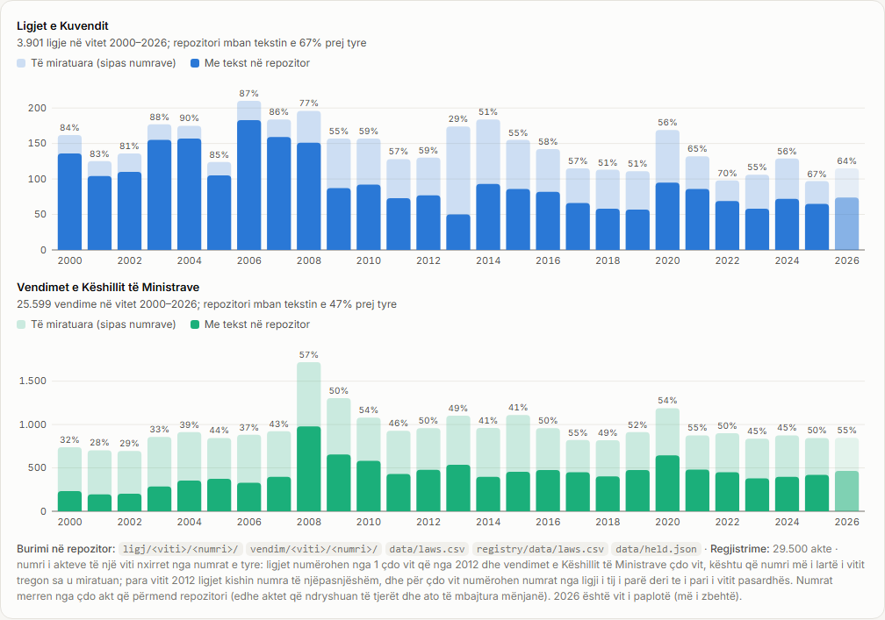

#### 2. Kalendari i Kuvendit

Ligjet sipas muajit dhe ditës së javës kur u miratuan: 72% të enjten, vetëm 2 në gusht në 27 vjet.

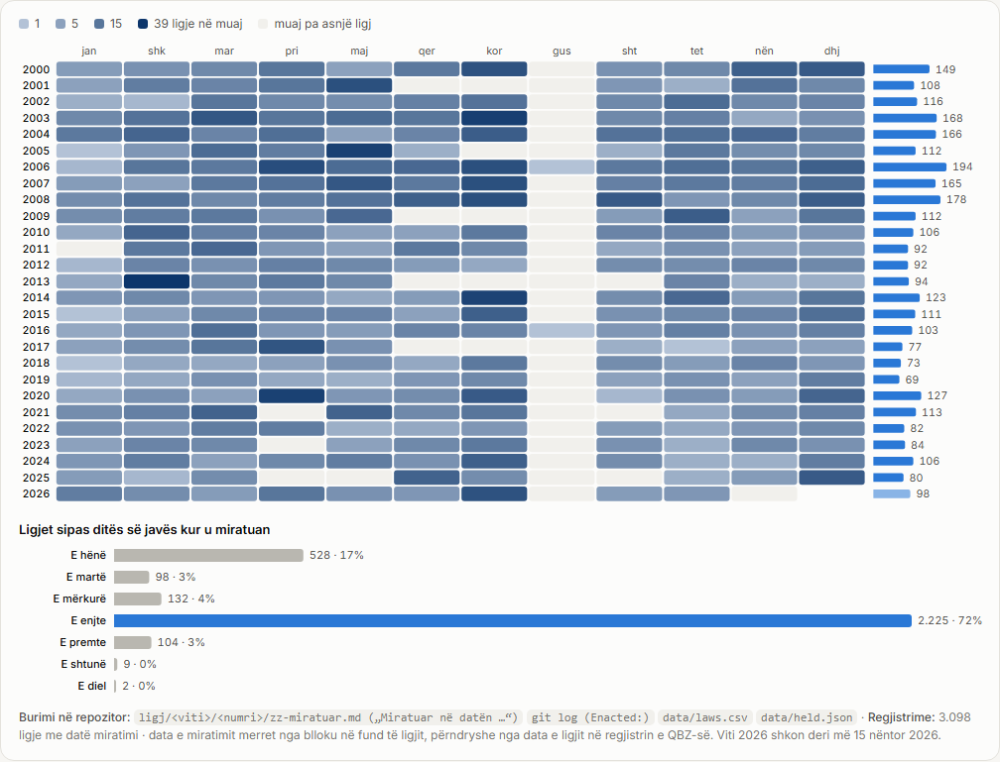

#### 3. Ligjet e reja zgjaten

Ligjet e reja sipas numrit të neneve, për çdo periudhë pesëvjeçare: mediana nga 17,5 nene në 31.

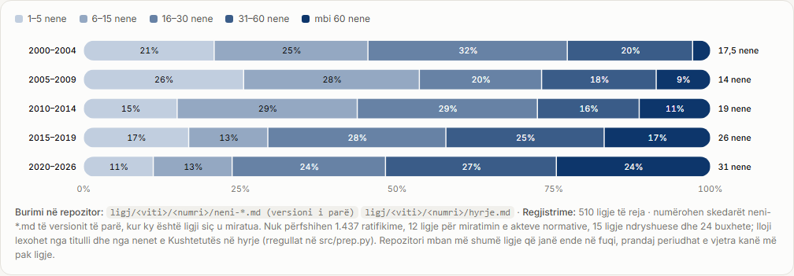

#### 4. Kuvendi përtej ligjeve

Vendimet, rezolutat dhe deklaratat e Kuvendit të viteve 2000–2010, sipas asaj që thotë titulli.

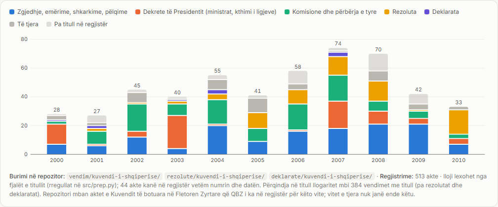

#### 5. Shpallja e ligjeve

Dekreti i Presidentit për çdo ligj, sipas vitit dhe Presidentit: në vitin 2021, gjysma e ligjeve u botuan pa dekret.

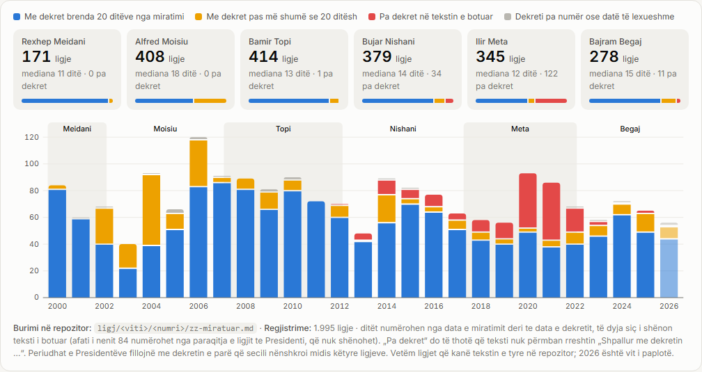

### II. Qeveria si ligjvënëse

#### 6. Aktet normative me fuqinë e ligjit

Çdo akt normativ i nenit 101 që nga viti 2000, sipas tremujorit, temës dhe Kryeministrit: 38 në vitin 2020, 36 në vitin 2021.

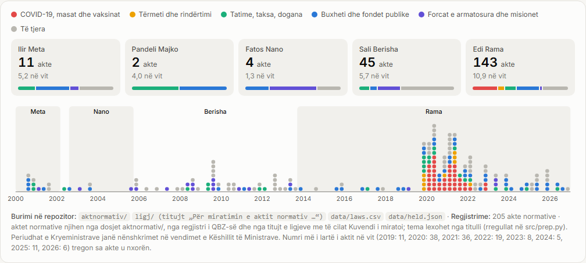

#### 7. Afati prej 45 ditësh

Sa ditë pas aktit normativ e miratoi Kuvendi: 197 nga 198 brenda afatit.

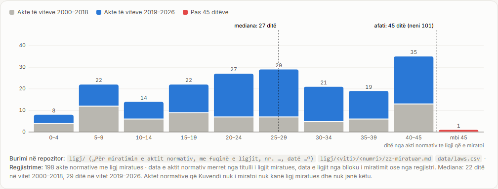

#### 8. Kush i propozon vendimet e qeverisë

Propozuesi i vendimeve të Këshillit të Ministrave, sipas fushës dhe vitit.

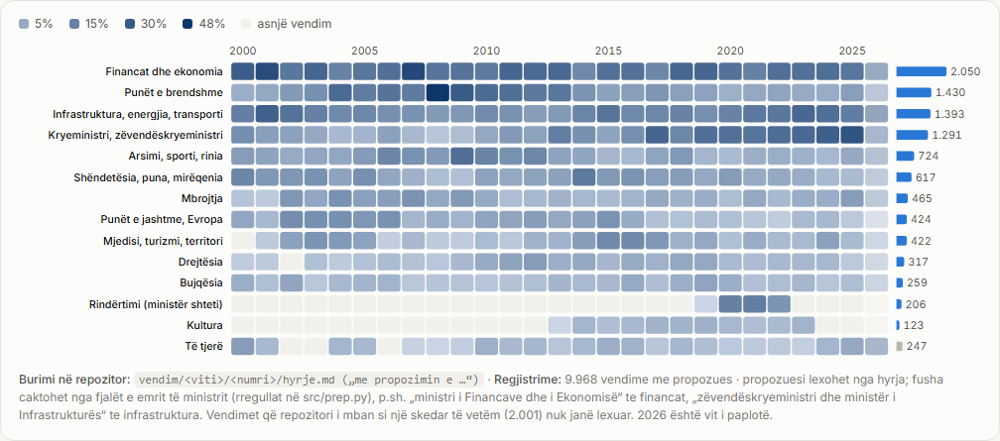

#### 9. Nga mbledhja e qeverisë te Fletorja Zyrtare

Ditët nga miratimi te botimi për vendimet e Këshillit të Ministrave dhe për ligjet: 36 në vitin 2009, 2 në vitin 2025.

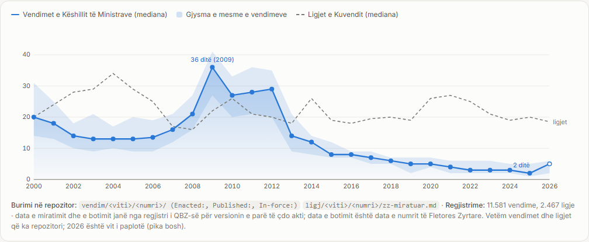

#### 10. Shpronësimet për interes publik

Vendimet për shpronësim sipas projektit dhe dhjetëvjeçarit: 52% për rrugë.

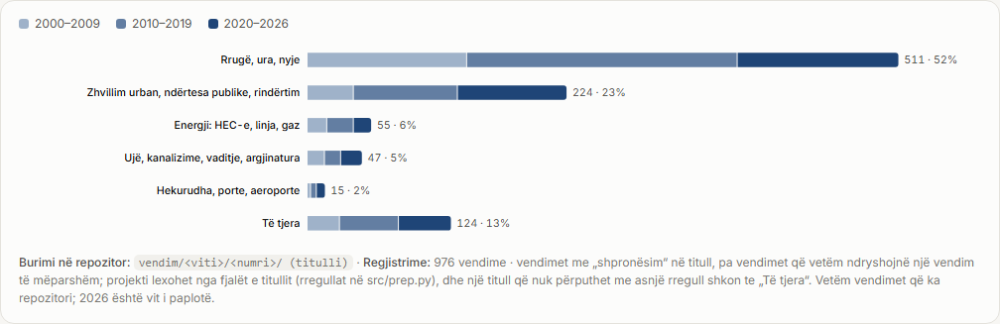

#### 11. Koncesionet

Vendimet dhe ligjet për koncesione sipas vitit dhe sektorit: 274 akte për hidrocentrale, 128 prej tyre në vitet 2007–2008.

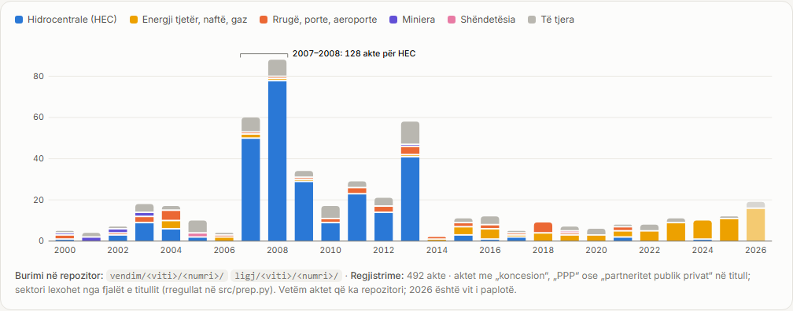

### III. Ministritë dhe numrat që vendos e drejta

#### 12. Udhëzimet dhe urdhrat

Udhëzimet dhe urdhrat sipas institucionit që i nxori: 36% nga Ministria e Bujqësisë.

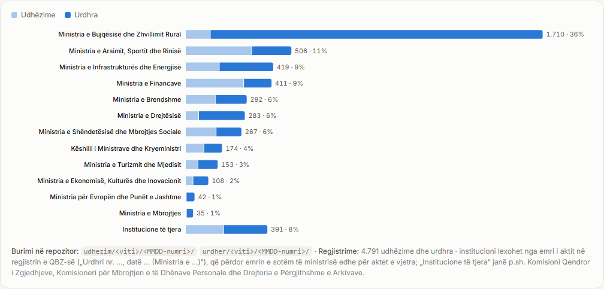

#### 13. Sëmundjet e kafshëve

Urdhrat me masa mbrojtëse ndaj sëmundjeve të kafshëve të shfaqura në shtete të tjera, sipas sëmundjes dhe muajit, dhe sa kohë mbetën në fuqi.

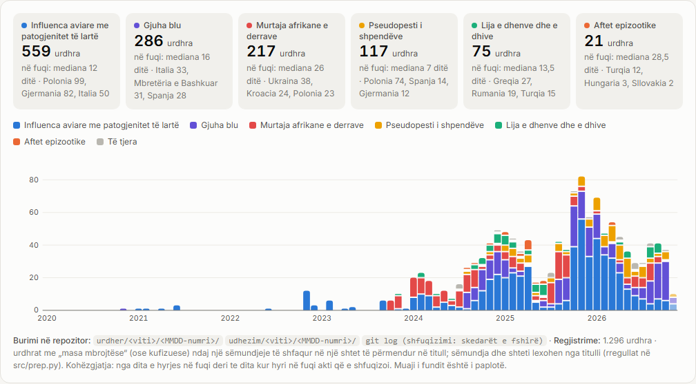

#### 14. Paga minimale

Çdo shumë e pagës minimale që nga viti 2000 dhe përqindja e rritjes së pensioneve me çdo vendim.

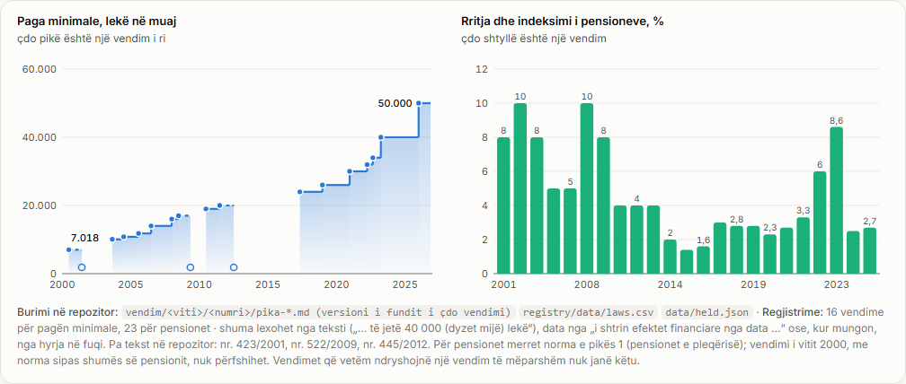

### IV. Si ndryshojnë dhe si shfuqizohen aktet

#### 15. Shfuqizimet

Aktet e shfuqizuara dhe versionet e reja çdo vit, sipas llojit të aktit, me urdhrat për sëmundjet e kafshëve më vete.

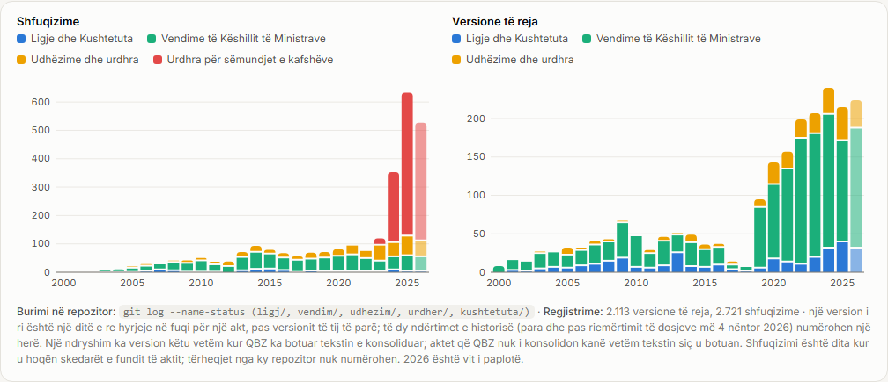

#### 16. Aktet që ndryshojnë më shpesh

Versionet e reja në vit për 20 aktet që kanë ndryshuar më shpesh; pesë prej tyre janë vendime për fondin e rindërtimit pas tërmetit të vitit 2019.

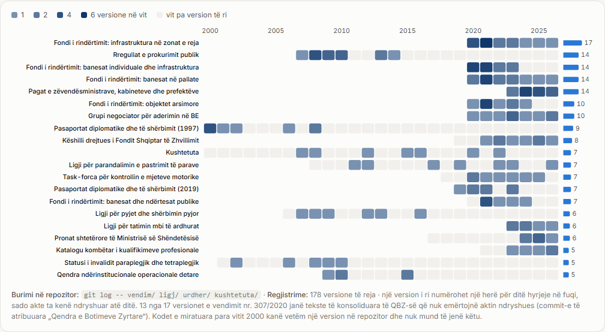

### V. Kushtetuta, gjykatat dhe marrëveshjet ndërkombëtare

#### 17. Kushtetuta

Dispozitat që shtoi, ndryshoi ose shfuqizoi secili nga shtatë ligjet ndryshuese, sipas pjesës: 57 në vitin 2016.

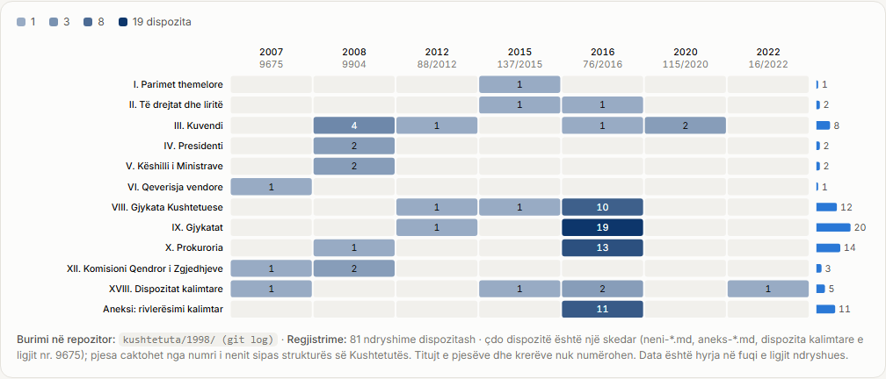

#### 18. Gjykatat në Fletoren Zyrtare

Vendimet e Gjykatës Kushtetuese, të Gjykatës së Lartë, të Gjykatës Evropiane të të Drejtave të Njeriut dhe të gjykatave të rretheve, sipas vitit, dhe ditët deri te botimi.

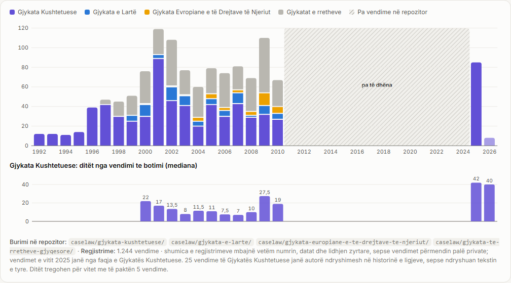

#### 19. Me kë lidh marrëveshje Shqipëria

Ligjet e ratifikimit sipas shtetit, në hartë dhe sipas dhjetëvjeçarit.

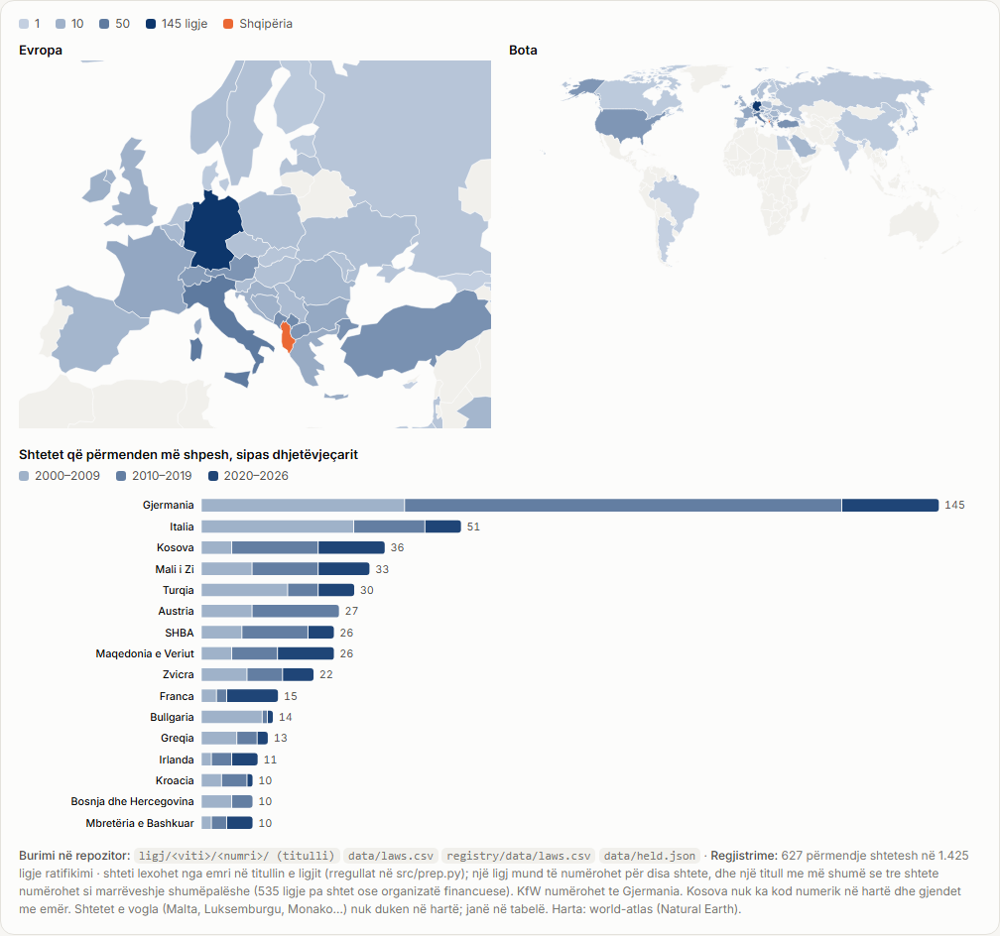

#### 20. Çfarë ratifikohet

Ligjet e ratifikimit sipas temës dhe, për huatë dhe financimet, sipas huadhënësit.

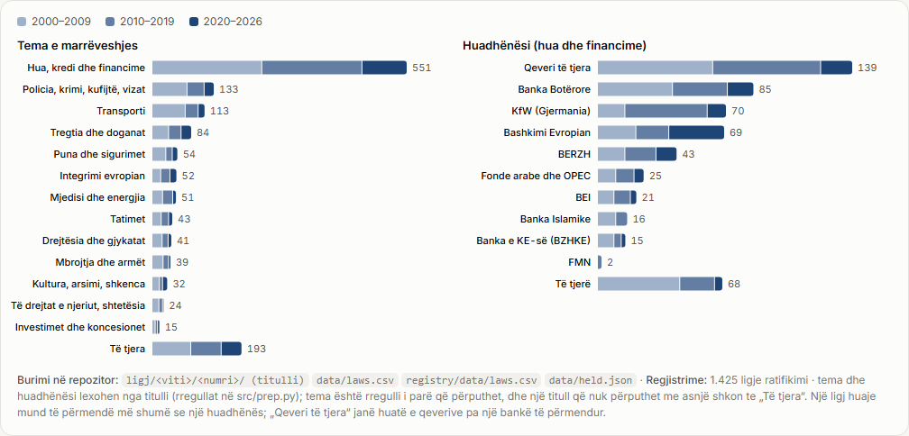

## Të dhënat

Gjendja në commit-in `0db29a98f9` (15 nëntor 2026).

| Të dhënat | Ku në repozitor | Regjistrime | Mbulimi |
| --- | --- | ---: | --- |
| Historia e gitit | dega `main` | 31.900 commit-e | data e çdo commit-i me tekst ligjor është dita kur versioni hyri në fuqi (`In-force:`) |
| Kushtetuta | `kushtetuta/1998/` | 8 versione | 1998–2022: teksti i vitit 1998 dhe shtatë ligjet ndryshuese |
| Ligjet | `ligj/<viti>/<numri>/` | 2.644 ligje (2.525 në fuqi); 3.155 ligje të njohura gjithsej | 1991–2026, kryesisht që nga viti 2000 |
| Aktet normative me fuqinë e ligjit | `aktnormativ/` dhe titujt e ligjeve që i miratuan | 54 akte me tekst; 205 të njohura | 2000–2026 |
| Vendimet e Këshillit të Ministrave | `vendim/<viti>/<numri>/` | 11.969 vendime (10.873 në fuqi) | 1993–2026, kryesisht që nga viti 2000 |
| Vendimet e organeve të tjera | `vendim/<institucioni>/` | 1.350 vendime | kryesisht 2000–2010 dhe 2026 |
| Udhëzimet dhe urdhrat | `udhezim/`, `urdher/` | 4.791 akte | 1994–2026 |
| Vendimet e gjykatave | `caselaw/` | 1.244 vendime | 1992–2010 dhe 2025–2026 |
| Aktet e mbajtura mënjanë | `data/held.json` | 3.935 akte | numri, data dhe titulli, për numërimin e akteve |

## Kufizimet

- **Repozitori mban kryesisht aktet në fuqi.** Ligjet dhe vendimet këtu janë kryesisht ato që QBZ i ka në regjistër si në fuqi ose të shfuqizuara më vonë; grafiku 1 tregon sa prej akteve të çdo viti ka repozitori. Ndër ligjet, ratifikimet janë më shumë se ndryshimet e ligjeve.
- **Kategoritë lexohen nga titujt.** Llojet në grafikët 3, 4, 6, 8, 10, 11, 12, 13, 19 dhe 20 lexohen nga fjalët e titullit ose të hyrjes, me rregullat në `src/prep.py`. Ajo që nuk e njeh asnjë rregull është „Të tjera“.
- **Versionet varen nga konsolidimi i QBZ-së.** Grafikët 15 dhe 16 numërojnë versionet që QBZ ka konsoliduar; kodet e miratuara para vitit 2000 kanë vetëm tekstin e sotëm.
- **Mungojnë vite.** Vendimet e gjykatave të viteve 2011–2024 dhe aktet e Kuvendit pas vitit 2010 nuk janë ende në repozitor (grafikët 4 dhe 18). Vendimet e këshillave bashkiakë nuk përdoren në këta grafikë.
- **Periudhat e paplota** (viti 2026, muaji i fundit) vizatohen më të zbehta dhe shënohen si të tilla.

## Si të rindërtohen grafikët

```sh
python visualisations/src/make.py            # historia e gitit + tabelat + tekstet -> src/.build/ -> e-drejta-shqiptare-ne-20-grafike.html
node visualisations/src/stills.cjs           # figurat për këto README (duhet Playwright; PLAYWRIGHT=<rruga>, nëse nuk është global)
```

`make.py` i lexon të gjitha nga objektet e gitit, prandaj punon edhe në një klon pa blob-e ose pa checkout (blob-et që i duhen i merr me një kërkesë për çdo hap). Si parazgjedhje lexon `origin/main` (ose `HEAD`); `--ref` zgjedh një degë ose commit tjetër. Në repozitor nuk shkruan asgjë tjetër përveç faqes dhe dosjes `src/.build/` (që git-i e injoron).

| Skedari | Çfarë bën |
| --- | --- |
| `src/make.py` | nxjerr historinë, tabelat dhe tekstet që duhen në `src/.build/`, pastaj nis `prep.py` dhe `build.py` |
| `src/prep.py` | llogarit të gjithë numrat e 20 grafikëve dhe profilin e të dhënave në `src/.build/data.json` |
| `src/page.tpl.html` | faqja: tekstet në të dy gjuhët, grafikët (d3), tabelat |
| `src/build.py` | vendos `data.json` në shabllon dhe shkruan faqen |
| `src/stills.cjs` | vizaton çdo grafik si PNG në `stills/sq/` dhe `stills/en/` |
