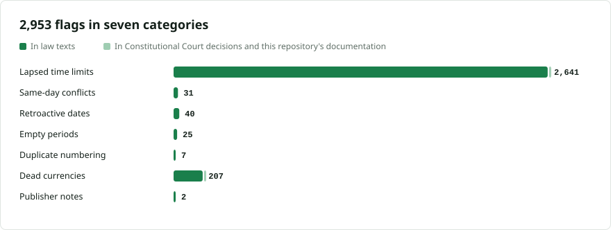

# Vulnerabilities in Albanian law

[Shqip](README.md) · **English**

<picture>
<source media="(prefers-color-scheme: dark)" srcset="img/flags-by-category-dark.svg">

</picture>

The vulnerability detectors from [lexifina/global-law](https://github.com/lexifina/global-law/tree/main/vulnerabilities) look for mechanical mistakes in legislation: a rule applying "until" a date that has passed, a time limit extended only after it had run out, two amendments to the same act on the same day, a rule in force before it was published. global-law's published list (9 November 2026) did not cover Albania, so this is a run over this repository only, as it stood at commit [`e29e247`](https://github.com/lexifina/albania-law/commit/e29e2477df2769a48f5a404c2b8435466e5b8935) on 15 November 2026.

**In short:** the detectors raised 2,974 flags. A language model reviewed 206 of the strongest, arguing each one for and against; 29 survived. Checked by hand in this repository, four flags in two decisions of the Council of Ministers and one law look like real lapses in Albanian law: the state of emergency in electricity supply (VKM 584/2021, point 5) ran out on 15 April 2022 and again on 30 June 2023, and each time was extended by a decision adopted after the end date, so it had ended from 16 to 28 April 2022 and from 1 to 27 July 2023; and the deadline to buy the land of privatised state properties (VKM 98/2009, point 3), 31 May 2009, was extended only from 6 October 2009; and the right to legalise capital and have part of a tax or customs debt forgiven (Law No. 10418/2011, neni 35) ended on 31 March 2012 and was extended to 31 March 2013 by Law No. 154/2013, which took effect only on 22 June 2013. In five more, the extension was published only after the old end date. Of the other 20, 9 come from how this repository dates or lays out its acts, 2 were misread by a detector, 7 are lawful, and 2 are spent. Later, this will be formalised in Lean, similar to our work on [the US tax code](https://lexifina.com/blog/formalizing-the-us-tax-code) and [US case law](https://lexifina.com/blog/formalizing-all-us-case-law-in-lean).

A flag is a prompt to look, not legal advice, and nothing here has been tested in court.

## Flags by category

| Category | What it looks for | Flags | In law texts | Reviewed | Survived review |
| --- | --- | ---: | ---: | ---: | ---: |
| Lapsed time limits | Text still applying a rule "until" a date that has passed | 2,640 | 2,634 | 110 | 3 |
| Same-day conflicts | Two acts changing the same provision on the same day | 31 | 31 | 31 | 6 |
| Retroactive or pre-publication dates | A rule in force before it was made or published | 40 | 40 | 40 | 6 |
| Empty periods | A time limit extended by an act that took effect after it had run out | 25 | 25 | 25 | 14 |
| Duplicate numbering | Two units with the same number in one provision | 7 | 7 | 0 | 0 |
| Dead currencies | Amounts in currencies no longer in use | 229 | 226 | 0 | 0 |
| Publisher notes | Notes that an amendment could not be carried out | 2 | 2 | 0 | 0 |

"In law texts" counts the Constitution, laws, normative acts with the force of law, decrees of the President, decisions of the Council of Ministers and of other bodies, instructions, orders and municipal council decisions. The other flags are in Constitutional Court decisions and in this repository's own documentation (its README, `REPRODUCE.md` and `registry/`), which are not law. The search for repeal gaps, stale amounts and references to deleted provisions found nothing to flag.

*Edge cases: the 29 flags that survived the review, grouped by what they turned out to be, and what the other flags are, in [EDGE-CASES.en.md](EDGE-CASES.en.md).*

## Problems found in this repository

- **First versions dated by the day of adoption:** 38 laws of the earlier build (the folders named `ligji-<nr>-<year>/` until 4 November 2026) have a first version in force on the day the Assembly adopted them, before they were published, although a law takes legal force only once published (Kushtetuta, neni 117, pika 1) and their own clauses give a later day ("hyn në fuqi në datën 1 shtator 2020" for Law No. 62/2020). 35 of them are still in the repository's current folders. They make up 38 of the 40 retroactive-date flags ([Edge cases](EDGE-CASES.en.md)).
- **Normative acts dated by adoption:** the README dates a change by a normative act with the force of law from its adoption, citing Kushtetuta neni 101, but that article does not name the day, and neni 117 pika 1 says the normative acts of the Council of Ministers take legal force only once published. Two acts are affected here: Akti normativ nr. 2/2023 (published 16 days after adoption) and nr. 7/2023 (2 days).
- **An annex is one file** (`zz-shtojca.md`): when an amending decision rewrites an annex, the detectors pair an old date with a new one from an unrelated sentence (3 of the 29 survivors, and 4 more flags the model did not keep).

## Files

| File | What it holds |
| --- | --- |
| [data/flags.csv](data/flags.csv) | Every flag, one row per provision and issue |
| [data/reviewed.csv](data/reviewed.csv) | The 206 flags the model reviewed, with its verdict and reason |
| [data/by_category.csv](data/by_category.csv) | The counts in the table above |
| [tools/](tools/) | The scripts that made this run |

Columns: `category` and `category_sq` (the category in English and Albanian), `detector`, `kind` (`law` or `other`), `path` (the file in this repository), `date` (the date the flag turns on), `reference` (the act or line involved), `summary`, `score` (the detector's ranking, 0 to 1), `review` (`artefact`, `lawful` or `candidate_defect`), `survives_rebuttal`, `review_note` (the model's reason, in English), `url` (the provision at the commit that was read, or, for one repealed since, at the last commit that held it; for retroactive dates, the commit that dated the act).

## How it was made

- **Detectors:** global-law's [vulnerabilities/scripts](https://github.com/lexifina/global-law/tree/main/vulnerabilities/scripts), run on this repository at commit `e29e247`. global-law's published list did not include Albania, so the history table the detectors read was built from this repository's own commits (the author, the act that made each change, and the `In-force` and `Kind` trailers; the kinds `decree`, `as-enacted` and `court` count as changes to the law, while `publisher`, the 755 changes no act is named for, and `caselaw` do not).
- **Model review:** gpt-5.4-mini, the 40 strongest flags per category (all of them for same-day conflicts and retroactive dates), and for lapsed time limits also the 40 strongest in law texts, which here are the same 40; one pass says whether a flag is real, a second argues that it is not. Empty periods use global-law's own review for that category, on all 25 flags, followed by the same second pass. Where a flag was reviewed twice, the later review is kept. global-law's own list used a different model.
- **Later runs:** the detectors were run again with fixes for Albanian date phrasing ("deri në datën ...", "deri në fund të vitit ...", "jo më vonë se ...", dates written with spaces or Roman-numeral months) and for currency names ("DM" only in capitals or right after an amount, "lire" only as a whole word, "lireta"); every review already made was kept and the strongest new flags were reviewed, so lapsed time limits carry 110 reviews.
- **Hand check:** every case that survived was read in this repository's history and texts. The amending decisions in the open cases are not held here as acts; their clauses are as QBZ quotes them in the version notes, and the Fletorja Zyrtare itself is still needed to rule out a clause that reaches back.

To report a correction, open an issue with the provision and an official source.

## Licence

The lists and notes are Lexifina's, dedicated to the public domain under CC0 1.0, like the rest of this repository's own contributions. Quoted law text is as the Qendra e Botimeve Zyrtare publishes it; Albania's copyright law (ligji nr. 35/2016, neni 12, pika 1, shkronja "b") excludes legal acts and their official collections from copyright; see [LICENSE](../LICENSE).
