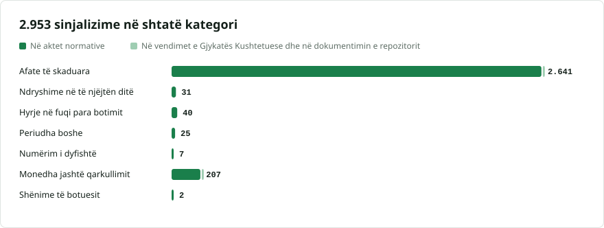

# Dobësi në legjislacionin shqiptar

**Shqip** · [English](README.en.md)

<picture>
<source media="(prefers-color-scheme: dark)" srcset="img/flags-by-category-dark.sq.svg">

</picture>

Detektorët e dobësive të repozitorit [lexifina/global-law](https://github.com/lexifina/global-law/tree/main/vulnerabilities) kërkojnë gabime mekanike në legjislacion: një rregull që ende zbatohet „deri më“ një datë që ka kaluar, një afat i zgjatur vetëm pasi kishte skaduar, dy ndryshime të të njëjtit akt në të njëjtën ditë, një rregull në fuqi para se të botohej. Lista që global-law publikoi më 9 nëntor 2026 nuk e përfshinte Shqipërinë, prandaj ky është një kontroll vetëm i këtij repozitori, në gjendjen e commit-it [`e29e247`](https://github.com/lexifina/albania-law/commit/e29e2477df2769a48f5a404c2b8435466e5b8935) të 15 nëntorit 2026.

**Shkurt:** detektorët dhanë 2.953 sinjalizime. Një model gjuhësor shqyrtoi 267 më të fortët, duke peshuar për secilin argumentet pro dhe kundër; 31 qëndruan. Të kontrolluara me dorë në këtë repozitor, katër sinjalizime në dy vendime të Këshillit të Ministrave dhe në një ligj duken si ndërprerje të vërteta në të drejtën shqiptare: gjendja e emergjencës në furnizimin me energji elektrike (VKM nr. 584/2021, pika 5) mbaroi më 15 prill 2022 dhe sërish më 30 qershor 2023, dhe të dyja herët u zgjat me vendim të miratuar pas datës së mbarimit, kështu që nuk ishte në fuqi nga 16 deri më 28 prill 2022 dhe nga 1 deri më 27 korrik 2023; dhe afati për blerjen e truallit të objekteve shtetërore të privatizuara (VKM nr. 98/2009, pika 3), 31 maj 2009, u zgjat vetëm nga 6 tetori 2009; dhe e drejta për legalizimin e kapitalit dhe faljen e një pjese të borxhit tatimor dhe doganor (ligji nr. 10418/2011, neni 35) mbaroi më 31 mars 2012 dhe u zgjat deri më 31 mars 2013 me ligjin nr. 154/2013, që hyri në fuqi vetëm më 22 qershor 2013. Në pesë të tjera, zgjatja u botua vetëm pas datës së vjetër të mbarimit. Nga 22 të tjerat, 9 vijnë nga mënyra si ky repozitor i daton ose i rendit aktet, 2 janë lexuar gabim nga detektori, 7 janë të ligjshme dhe 4 janë shteruar. Më vonë kjo do të formalizohet në Lean, ngjashëm me punën tonë për [kodin tatimor të SHBA-së](https://lexifina.com/blog/formalizing-the-us-tax-code) dhe [praktikën gjyqësore të SHBA-së](https://lexifina.com/blog/formalizing-all-us-case-law-in-lean).

Një sinjalizim është ftesë për ta parë më nga afër, jo këshillë ligjore, dhe asgjë këtu nuk është provuar para gjykatës.

## Sinjalizimet sipas kategorisë

| Kategoria | Çfarë kërkon | Sinjalizime | Në aktet normative | Të shqyrtuara | Qëndruan pas shqyrtimit |
| --- | --- | ---: | ---: | ---: | ---: |
| Afate të skaduara | Tekst që ende zbaton një rregull „deri më“ një datë që ka kaluar | 2.641 | 2.635 | 171 | 5 |
| Ndryshime në të njëjtën ditë | Dy akte që ndryshojnë të njëjtën dispozitë në të njëjtën ditë | 31 | 31 | 31 | 6 |
| Hyrje në fuqi para botimit | Rregull në fuqi para se të miratohej ose të botohej | 40 | 40 | 40 | 6 |
| Periudha boshe | Afat i zgjatur nga një akt që hyri në fuqi pasi afati kishte skaduar | 25 | 25 | 25 | 14 |
| Numërim i dyfishtë | Dy njësi me të njëjtin numër në një dispozitë | 7 | 7 | 0 | 0 |
| Monedha jashtë qarkullimit | Shuma në monedha që nuk përdoren më | 207 | 205 | 0 | 0 |
| Shënime të botuesit | Shënime se një ndryshim nuk mund të pasqyrohej | 2 | 2 | 0 | 0 |

„Në aktet normative“ përfshin Kushtetutën, ligjet, aktet normative me fuqinë e ligjit, dekretet e Presidentit, vendimet e Këshillit të Ministrave dhe të organeve të tjera, udhëzimet, urdhrat dhe vendimet e këshillave bashkiakë. Sinjalizimet e tjera janë në vendimet e Gjykatës Kushtetuese dhe në dokumentimin e vetë repozitorit (README, `REPRODUCE.md` dhe `registry/`), që nuk janë akte normative. Kërkimi për boshllëqe pas shfuqizimit, shuma të vjetruara dhe referime në dispozita të shfuqizuara nuk gjeti asgjë për të sinjalizuar.

*Rastet kufitare: 31 sinjalizimet që qëndruan pas shqyrtimit, të grupuara sipas asaj që rezultuan të jenë, dhe çfarë janë sinjalizimet e tjera, në [EDGE-CASES.md](EDGE-CASES.md).*

## Probleme të gjetura në këtë repozitor

- **Versione të para të datuara me ditën e miratimit:** 38 ligje të ndërtimit të mëparshëm (në dosjet `ligji-<nr>-<vit>/` deri më 4 nëntor 2026) kanë një version të parë në fuqi që nga dita kur i miratoi Kuvendi, para se të botoheshin, ndonëse ligji merr fuqi juridike vetëm pasi botohet (Kushtetuta, neni 117, pika 1) dhe dispozitat e tyre për hyrjen në fuqi caktojnë një ditë të mëvonshme („hyn në fuqi në datën 1 shtator 2020“ për ligjin nr. 62/2020). 35 prej tyre janë ende në dosjet e sotme të repozitorit. Ato përbëjnë 38 nga 40 sinjalizimet për hyrje në fuqi para botimit ([rastet kufitare](EDGE-CASES.md)).
- **Akte normative të datuara me ditën e miratimit:** README daton ndryshimin që bën një akt normativ me fuqinë e ligjit nga dita e miratimit, duke cituar nenin 101 të Kushtetutës, por ky nen nuk e përcakton atë ditë, ndërsa neni 117, pika 1, thotë se aktet normative të Këshillit të Ministrave marrin fuqi juridike vetëm pasi botohen. Këtu preken dy akte: akti normativ nr. 2/2023 (i botuar 16 ditë pas miratimit) dhe nr. 7/2023 (2 ditë).
- **Një shtojcë është një skedar i vetëm** (`zz-shtojca.md`): kur një vendim ndryshues e rishkruan një shtojcë, detektorët çiftojnë një datë të vjetër me një të re nga një fjali që s'ka lidhje me të (3 nga 31 sinjalizimet që qëndruan, dhe 4 të tjera që modeli nuk i mbajti).
- **Një skedar mund të mbajë më shumë se pikën e vet:** në udhëzimin nr. 18, datë 20.8.2019 („Për vitin shkollor 2019-2020 në sistemin arsimor parauniversitar“), çdo nënndarje i numëron pikat e veta nga 1, dhe `udhezim/2019/0820-18/pika-009.md` mban pikën 9 të nënndarjes I.1 dhe bashkë me të pjesën tjetër të udhëzimit, nga nënndarja I.2 deri te kreu IV, dispozitat e fundit (1 nga 31 sinjalizimet që qëndruan).

## Skedarët

| Skedari | Çfarë përmban |
| --- | --- |
| [data/flags.csv](data/flags.csv) | Çdo sinjalizim, një rresht për dispozitë dhe problem |
| [data/reviewed.csv](data/reviewed.csv) | 267 sinjalizimet që shqyrtoi modeli, me vlerësimin dhe arsyetimin e tij |
| [data/by_category.csv](data/by_category.csv) | Numrat e tabelës më sipër |
| [tools/](tools/) | Skriptet me të cilat u bë ky kontroll |

Kolonat: `category` dhe `category_sq` (kategoria në anglisht dhe në shqip), `detector`, `kind` (`law` ose `other`), `path` (skedari në këtë repozitor), `date` (data me të cilën lidhet sinjalizimi), `reference` (akti ose rreshti në fjalë), `summary`, `score` (renditja e detektorit, nga 0 në 1), `review` (`artefact`, `lawful` ose `candidate_defect`), `survives_rebuttal`, `review_note` (arsyetimi i modelit, në anglisht), `url` (dispozita në commit-in që u lexua, ose, për një dispozitë të shfuqizuar që atëherë, në commit-in e fundit që e mbante; për hyrjen në fuqi para botimit, commit-i që e datoi aktin).

## Si u bë

- **Detektorët:** [vulnerabilities/scripts](https://github.com/lexifina/global-law/tree/main/vulnerabilities/scripts) i global-law, të ekzekutuar mbi këtë repozitor në commit-in `e29e247`. Lista e publikuar e global-law nuk e përfshinte Shqipërinë, prandaj tabela e historisë që lexojnë detektorët u ndërtua nga vetë commit-et e këtij repozitori (autori, pra akti që bëri çdo ndryshim, dhe trailer-at `In-force` dhe `Kind`; llojet `decree`, `as-enacted` dhe `court` llogariten si ndryshime të së drejtës, ndërsa `publisher`, 755 ndryshimet për të cilat nuk emërtohet asnjë akt, dhe `caselaw` jo).
- **Shqyrtimi nga modeli:** gpt-5.4-mini, 40 sinjalizimet më të forta për çdo kategori (të gjitha, për ndryshimet në të njëjtën ditë dhe hyrjen në fuqi para botimit), dhe për afatet e skaduara edhe 40 më të fortët në aktet normative, që këtu janë po ato 40; një kalim thotë nëse sinjalizimi është i vërtetë, një i dytë argumenton se nuk është. Periudhat boshe përdorin shqyrtimin e vetë global-law për këtë kategori, për të 25 sinjalizimet, të ndjekur nga i njëjti kalim i dytë. Kur një sinjalizim është shqyrtuar dy herë, mbahet shqyrtimi i mëvonshëm. Lista e vetë global-law përdori një model tjetër.
- **Ekzekutimet e mëvonshme:** detektorët u ekzekutuan sërish me korrigjime për mënyrën shqip të shkrimit të datave („deri në datën ...“, „deri në fund të vitit ...“, „jo më vonë se ...“, data të shkruara me hapësira ose me muajin me numra romakë) dhe për emrat e monedhave („DM“ vetëm me shkronja të mëdha ose menjëherë pas një shume, „lire“ vetëm si fjalë e plotë, „lireta“); çdo shqyrtim i bërë më parë u ruajt dhe u shqyrtuan sinjalizimet e reja më të forta, kështu që afatet e skaduara kanë 110 shqyrtime. Një kalim i dytë, pas një korrigjimi në mënyrën si skanimet e ndajnë punën, shqyrtoi edhe 29 afate të skaduara me të njëjtin vlerësim si më të fortët; asnjë nuk qëndroi.
- **Pas zhvendosjes së dosjeve të akteve:** më 4 nëntor 2026 ky repozitor zhvendosi 770 akte nga dosje të emërtuara sipas identifikuesit të tyre (`ligji-62-2020/`) në `<kind>/<year>/<number>/` (`data/paths.json`). Çdo commit para zhvendosjes e emërton skedarin sipas dosjes së vjetër, prandaj detektorët, që i grupojnë skedarët sipas dosjes, e shihnin historinë e secilit prej këtyre akteve të ndarë në dysh në ditën e zhvendosjes. Tabela e historisë u rishkrua sipas dosjeve të reja dhe të gjithë hapat u ekzekutuan sërish, duke ruajtur çdo shqyrtim të bërë më parë. Detektorët tani e lexojnë latsin letonez vetëm si fjalët „lati“ dhe „latu“, gjë që hoqi 22 „pallati“ (monedhat jashtë qarkullimit zbritën nga 229 në 207), dhe një afat i skaduar më shumë është një datë që kaloi pas ekzekutimit të mëparshëm. Përzgjedhja e sërishme e më të fortëve ndër sinjalizimet me të njëjtin vlerësim i dërgoi modelit 34 afate të skaduara të pashqyrtuara më parë, ndërsa dy sinjalizime që ndanin shqyrtimin me një sinjalizim tjetër me të njëjtat fjalë në fillim nuk e ndajnë më (171 gjithsej); dy nga të rejat qëndruan, dhe të dyja janë shteruar. Kategoritë e tjera nuk ndryshuan.
- **Kontrolli me dorë:** çdo rast që qëndroi u lexua në historinë dhe tekstet e këtij repozitori. Vendimet ndryshuese të rasteve të hapura nuk mbahen këtu si akte; dispozitat e tyre për hyrjen në fuqi janë ashtu siç i citon QBZ në shënimet e versioneve, dhe duhet ende vetë Fletorja Zyrtare për të përjashtuar ndonjë dispozitë që u jep efekt prapaveprues.

Një korrigjim mund ta raportoni duke hapur një issue me dispozitën dhe një burim zyrtar.

## Licenca

Listat dhe shënimet janë vepër e Lexifina-s, të vëna në domenin publik sipas CC0 1.0, si edhe kontributet e tjera të vetë këtij repozitori. Teksti ligjor i cituar është ashtu siç e boton Qendra e Botimeve Zyrtare; ligji shqiptar për të drejtën e autorit (ligji nr. 35/2016, neni 12, pika 1, shkronja „b“) përjashton aktet ligjore dhe përmbledhjet e tyre zyrtare nga e drejta e autorit; shih [LICENSE](../LICENSE).

Ky është përkthim i versionit në anglisht ([README.en.md](README.en.md)); nëse ndryshojnë, vlen versioni në anglisht.
